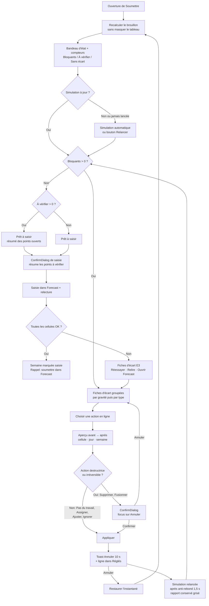

# Squad Decisions

## Active Decisions

### 2026-09-01T08:31:58-04:00: Équipe Squad embauchée pour gl-librairie-martin-slim

**By:** Eric De Carufel (via Copilot / Squad Coordinator)
**What:** Équipe montée avec des noms de personas explicitement fournis par l'utilisateur (multi-univers, override intentionnel du casting mono-univers habituel) :

- Yoda — Architecte
- Morpheus — Product Owner
- Cendrillon — Développeur Frontend
- Glados — Développeur Backend
- Inspecteur Gadget — Testeur
- Mafia Boy — Hacker / Sécurité
- Martha Stewart — Designer UI/UX
- Zeus — Expert Cloud
- R2-D2 — Expert DevOps
- Jar Jar Binks — User (persona IA, voix utilisateur)
- Scribe, Ralph, Rai, Fact Checker — membres intégrés toujours actifs

**Why:** Demande explicite de l'utilisateur avec personas nommés. `stateBackend` basculé de `"teamRoot" externe` (pointant vers un ancien casting "Matrix" inactif et roster vide) vers `"local"` pour que l'état vive dans ce repo et soit versionnable.

### 2026-09-21: Correction vulnérabilité Oracle.ManagedDataAccess.Core (GHSA-5pm2-9mr2-3frq)

**By:** Glados (Développeur Backend), demandé par Eric De Carufel
**What:** Promotion de `Oracle.ManagedDataAccess.Core` d'une dépendance transitive (2.19.110, vulnérable — CVE-2023-21893) vers une `PackageReference` directe en version 2.19.180 dans `LibrairieMartinSlim.Infrastructure.csproj`.
**Why:** Le package transitif n'était pas contrôlable directement pour forcer la version corrigée ; ajouter une référence directe garantit que la version patchée (>= 2.19.180) est utilisée partout, éliminant la faille de type "component takeover" (CVSS 7.5). Build et 923/924 tests unitaires passent après le changement (1 skip attendu, nécessite une connexion SQL live).

### 2026-09-29: Ajout de Jimmy Neutron — Spécialiste Documentation Technique

**By:** Félix Noël (via Copilot / Squad Coordinator)
**What:** Ajout d'un nouveau membre d'équipe, Jimmy Neutron, avec pour mandat exclusif la documentation technique du projet sous `/docs`. Il s'appuie sur le skill `documentation-nexus` (plugin `core` du nexus-plugin-marketplace) comme unique source d'autorité pour les templates, la structure, les conventions de nommage et le profil de plateforme (GitHub repo docs). Roster (`team.md`) et table de routage (`routing.md`) mis à jour ; charter et history créés dans `.squad/agents/jimmy/`.
**Why:** Demande explicite de l'utilisateur pour formaliser un rôle dédié au maintien de `/docs` en synchronisation avec les changements de code, plutôt que de laisser cette responsabilité diffuse entre Yoda (architecture) et les développeurs.

### 2026-09-29: Migration de `/docs` vers le standard documentation-nexus

**By:** Jimmy Neutron (Spécialiste Documentation Technique), avec Yoda (Architecte) et Morpheus (Product Owner) en revue de contenu, à la demande de Félix Noël
**What:** Exécution du flow `migrate` du skill `documentation-nexus` sur `/docs` (plateforme `github-repo-docs`, langue française). L'ancien `docs/architecture/*.md` (11 fichiers) a été restructuré en :

- `Index.md`, `Contexte-Projet.md`, `Architecture.md`, `Setup-Dev.md`, `Branches-Et-PR.md`, `Deploiement.md`, `Annexe-Liens.md` (7 pages requises)
- `Decisions-Architecturales/` — 6 ADR extraits de `deploiement-azure.md` §2 (monolithe modulaire, base par tenant, référentiel bibliographique mutualisé, App Service/Functions, caisse PWA/agent local, deux régions canadiennes)
- `Domaine/SLIM.md` + `Domaine/SLIM/{7 modules}.md` — diagrammes de schéma DB par module (issus de `diagramme-global.md` + `module-*.md`)
- `Guides-Et-References/Lexique-Domaine.md` et `Strategie-Hebergement-Base-De-Donnees-Multi-Tenant.md`

`docs/PRD.md` a été déplacé (intact, `git mv`) vers `cadrage/PRD/PRD.md` — c'est un artefact de cadrage (rétro-ingénierie SLIM 1.0), pas une page technique du catalogue nexus ; son contenu (acteurs, workflows, règles d'affaires) a été miné pour peupler `Contexte-Projet.md` et les sections `Fonctionnalités`/`Dépendances` des pages `Domaine/`.

`/cadrage` n'a pas été migré (hors mandat de `/docs`) — seulement utilisé comme source de contexte.

**Why:** Demande explicite de l'utilisateur pour scaffolder + migrer la documentation existante vers le standard Nexus, en s'appuyant sur `documentation-nexus` comme unique source d'autorité (mandat de Jimmy). Décisions de scope confirmées par l'utilisateur en cours de route : langue française, plateforme GitHub repo docs, exclusion de `/cadrage` du périmètre de migration, relocalisation du PRD.

**Ouvert / suivi requis :**

- ~~Deux URLs Azure Boards différentes trouvées~~ — clarifié par Félix Noël (2026-09-29) :
  `dev.azure.com/librairie-martin/SLIM` est le système historique SLIM 1.0 (remplacé par ce
  projet) ; `dev.azure.com/nexusinno/Librairie Martin - SLIM v2` est le backlog du nouveau projet.
  Mis à jour dans `Annexe-Liens.md`.

### 2026-09-29: Extraction du module "Achats & Approvisionnement" dans `docs/Domaine`

**By:** Jimmy Neutron (Spécialiste Documentation Technique), à la demande de Félix Noël
**What:** Extraction du contenu "Achats & Approvisionnement" en page de module dédiée (`docs/Domaine/SLIM/Achats-Et-Approvisionnement.md`), sur le même modèle que `Rapports-Et-Exports.md`. Le contenu était auparavant dispersé entre `Produits-Catalogue.md` (seuils de réassort) et `Ventes-Commandes.md` (3 fonctionnalités liées aux commandes fournisseurs) et n'était pas découvrable comme module autonome. Contenu déplacé (pas dupliqué) : 3 fonctionnalités retirées de `Ventes-Commandes.md` (sections Limites/Dépendances mises à jour), 1 fonctionnalité retirée de `Produits-Catalogue.md` (Seuils de réassort conservé avec note de renvoi croisé), une référence corrigée dans `Needa.md`, et une ligne ajoutée dans `docs/Domaine/SLIM.md`.
**Why:** Signalement de l'utilisateur que ce contenu n'était pas identifiable comme module à part entière dans la documentation. Vérifié contre le PRD pour complétude ; aucune référence croisée PRD ↔ Domaine introduite.

### 2026-09-29: Nouveau module "Rapports & Exports" dans docs/Domaine/SLIM

**By:** Jimmy Neutron (Spécialiste Documentation Technique)
**What:** Création d'une 8e page de module, `docs/Domaine/SLIM/Rapports-Et-Exports.md`, avec sa
ligne ajoutée au tableau des modules de `docs/Domaine/SLIM.md`. À la différence des 7 autres
modules (découpés par propriété physique de tables), celui-ci ne possède aucune table dédiée —
c'est un regroupement par capacité fonctionnelle uniquement (documenté explicitement dans la page
et via une note sous le tableau de `SLIM.md`). Le diagramme global des 118 tables n'est pas
modifié.
**Why:** L'audit comparatif PRD (`cadrage/PRD/PRD.md`) ↔ `docs/Domaine/SLIM/` a révélé un domaine
fonctionnel entier sans foyer logique dans les 7 modules existants : rapports opérationnels
(WF-014), export comptable (Acomba/Sage/QuickBooks Online), et transmission planifiée de données
aux partenaires du livre autres que Needa (Gaspard, LIQ). `Systeme-Configuration.md` est
explicitement scopé aux paramètres/traductions/contenu web ; rattacher ces capacités à
`Ventes-Commandes.md` ou `Produits-Catalogue.md` aurait mélangé des préoccupations transverses avec
des modules déjà denses. Hors scope volontaire : imports catalogue Vigie/Gaspard (restent dans
`Produits-Catalogue.md`, ce sont des imports entrants) et paiement en ligne WF-005 (reste dans
`Ventes-Commandes.md`). Aucune référence croisée introduite vers `cadrage/PRD/PRD.md` (vérifié par
grep).

- `Setup-Dev.md` et `Branches-Et-PR.md` contiennent des TODO significatifs (aucune documentation
  source existante) — un passage `fill` sera lancé sur confirmation de l'utilisateur.
- Table des parties prenantes dans `Contexte-Projet.md` à valider avec l'équipe — sera complétée
  dans le même passage `fill`.

### 2026-09-30T16:01:31-04:00: Modèles Anthropic uniquement — `model` explicite obligatoire à chaque spawn (consolidated)

**By:** Eric De Carufel (User Directive + Coordinator Implementation)
**Supersedes:** User directive 2026-09-30T11:49:10-04:00
**What:** Tous les agents doivent tourner exclusivement sur des modèles Anthropic (`claude-haiku-*`, `claude-sonnet-*`, `claude-opus-*`) pour réduire les coûts. Directives par complexité de tâche:

- Tâche bien définie, décrite étape par étape → `claude-haiku-4.5`
- Tâche normale → `claude-sonnet-5.5`
- Tâche plus compliquée → `claude-opus-5.5`

Le coordinateur doit TOUJOURS passer `model` explicitement à chaque spawn (jamais d'omission = défaut plateforme). Politique persistée dans `.squad/config.json` (`modelPolicy`), `routing.md` (règle 9), `.squad/templates/model-selection-reference.md` et `squad.agent.md`.
**Why:** User request to reduce costs by enforcing Anthropic-only models. Des agents étaient lancés sans paramètre `model` et héritaient du modèle par défaut de la plateforme (GPT), malgré les charters Anthropic-only. `config.json`, `routing.md` et `decisions.md` survivent à `squad upgrade`, contrairement à `squad.agent.md` et aux templates.

### 2026-10-01: Configuration frontend par environnement injectée au déploiement

**By:** R2-D2 (Expert DevOps), demandé par Hélène Lebrun (config.js de dev exposé sur l'URL de prod)
**What:** `src/frontend/public/configs/config.<env>.js` existe pour dev/uat/prod ; le déploiement frontend (`deploy-stage-swa.yml`, `deploy-stage.yml`) copie le fichier de l'environnement sur `config.js`, supprime `configs/` du package et échoue si le fichier est absent. `TENANT_ID`/`CLIENT_ID` sont des placeholders remplacés par les variables secrètes `frontendTenantId`/`frontendClientId`. Les groupes de variables `librairie-martin-slim-v2-<env>-secrets` (créés manuellement, un par environnement) contiennent aussi `sqlAdministratorLoginPassword` (valeur aléatoire distincte par environnement) ; ils sont liés dans le YAML aux jobs `DeployInfra` et de déploiement applicatif. ADR : `docs/Decisions-Architecturales/2026-10-01-Configuration-Frontend-Par-Environnement.md` ; procédure : `pipelines/variable-groups.md`.
**Why:** Servir `configs/` exposait la config de tous les environnements, et une config manquante déployait silencieusement celle de dev en prod. Un `$(variable)` ADO non défini est transmis tel quel : sans groupe, le mot de passe admin SQL aurait été le texte littéral `$(sqlAdministratorLoginPassword)`. Les IDs Entra d'une SPA restent visibles côté navigateur — le statut secret ne protège que les journaux et le dépôt.

#### 2026-10-07: Azure SQL en authentification Entra-only — plus de mot de passe admin SQL

**By:** Zeus (Expert Cloud), demandé par Eric De Carufel (approche D, dev/uat/prod)
**What:** `sqlDatabase.bicep` crée le serveur avec un bloc `administrators` inline (`azureADOnlyAuthentication: true`, sans `administratorLogin`/`administratorLoginPassword`, comme le module AVM `sql/server`) et applique `Microsoft.Sql/servers/azureADOnlyAuthentications` (`Default`) après l'admin Entra (`servers/administrators`) pour les serveurs existants. Les paramètres `sqlAdministratorLogin`/`sqlAdministratorLoginPassword` sont supprimés de `main.bicep`, `main.entrypoint.bicep` et `deploy-bicep-for-environment.ps1`. `keyVaultRoleAssignment.bicep` accepte `roleDefinitionId`/`principalType` ; `main.bicep` ajoute `keyVaultSecretsOfficerGroupObjectId` (optionnel, groupe `lmslim-<env>-kv-secrets-officers`, rôle Key Vault Secrets Officer). `pipelineServicePrincipalObjectId` est renseigné dans les trois `.bicepparam`. Le Key Vault ne contient que `teamsWebhookUrl`.
**Why:** Éliminer le seul secret d'infra (mot de passe admin SQL) ; tous les accès SQL (backend UAMI, UAMI dba, SP du pipeline) étaient déjà Entra. Break-glass = admin Entra (UAMI dba par défaut, ou un groupe qui contient la UAMI dba).

#### 2026-10-07: Plus aucun groupe de variables Library ; seul secret `teamsWebhookUrl` lu dans Key Vault par Notify

**By:** R2-D2 (Expert DevOps), approche D validée par Eric De Carufel
**What:**

- Les jobs `DeployInfra`, déploiement applicatif et `NotifyTeams` ne lient plus `librairie-martin-slim-v2-<env>-secrets`. Les groupes sont à supprimer après une exécution validée par environnement.
- SQL en authentification Entra uniquement (Zeus) : plus de `SQL_ADMINISTRATOR_LOGIN_PASSWORD` côté pipeline.
- `Notify_<env>` lit `teamsWebhookUrl` avec `AzureKeyVault@2` (connexion de service de l'environnement, coffre `<applications[0].name>-<env>-kv`, `RunAsPreJob: false`, `continueOnError: true`). On n'utilise pas un groupe Library lié au coffre : il ferait échouer tout le job avant la première étape si le coffre ou le secret manque, contrairement à « Notify ne fait jamais échouer le pipeline ». Une rotation dans Key Vault ne demande aucune exécution de pipeline.
- `azureAdTenantId` / `azureAdClientId` (pas des secrets) sont des champs de chaque environnement dans `pipelines/azure-pipelines.yml`, à garder synchronisés avec `main.<env>.bicepparam`. Le déploiement frontend échoue si l'un est vide.
  **Why:** Supprimer le mot de passe SQL et les secrets gérés à la main dans Azure DevOps ; Key Vault devient la seule source de vérité (RBAC, PIM, historique des versions). Procédure : `pipelines/variable-groups.md`.

#### 2026-10-05 : AppHost Aspire comme source de vérité SQL Server, Compose comme artefact généré

**By:** R2-D2 (Expert DevOps), demandé par Eric Decarufel
**Status:** Recommandation à valider par l'équipe
**What:** Déclarer SQL Server une seule fois dans `LibrairieMartinSlim.AppHost` avec `Aspire.Hosting.SqlServer`, y conserver image/tag, secret, volume et endpoint, puis produire les fichiers Compose consommables par Docker/CI avec `Aspire.Hosting.Docker` (`aspire publish`). Ne pas importer le `docker-compose.yml` dans l'AppHost : aucune API/package officiel ou Toolkit d'import runtime n'a été vérifié. Ajouter `CommunityToolkit.Aspire.Hosting.SqlDatabaseProjects` si le DACPAC doit être déployé dans le cycle Aspire; réserver `WithCreationScript` à un bootstrap SQL léger, pas au déploiement du schéma.
**Why:** Le projet utilise déjà Aspire 13.6.0 et possède des ressources SQL Server, API et Vite dans l'AppHost. L'intégration Docker 13.6.0 génère `docker-compose.yaml` et `.env` depuis ce modèle, tandis que la ressource SQL Server Aspire fournit connexion, health check et orchestration `WaitFor`. Le Toolkit SQL Database Projects 13.6.0 prend en charge Microsoft.Build.Sql et publie le DACPAC. Un Compose généré contient tout le modèle; les consommateurs externes peuvent cibler seulement le service SQL. La création `AddDatabase` et le déploiement du DACPAC requièrent le cycle AppHost; `docker compose up` seul n'exécute pas ces gestionnaires.
**Caveats:** Vérifier le mapping endpoint/port, le healthcheck Compose et les artefacts réels avant de retirer le Compose maintenu à la main. Vérifier aussi l'écart local actuel entre le nom SQL `LibrairieMartinSlim` dans AppHost et la cible `LibrairieMartinSlim.Database` dans le README du sqlproj. L'export Compose n'est pas un import et les API de Dockerfile-builder sont marquées expérimentales; ce choix ne les nécessite pas pour le SQL Server existant.

#### 2026-10-08T14-55-36: ADR-8 (proposé) : abstraction de l'accès aux données SLIM 1.0 / 2.0 par ports Domain, adapters Slim1 (jetable) / Slim2, backend choisi par tenant+module.

**By:** Yoda (Architecte)
**What:** ADR-8 (proposé) : abstraction de l'accès aux données SLIM 1.0 / 2.0 par ports Domain, adapters Slim1 (jetable) / Slim2, backend choisi par tenant+module.
**References:** ADO 74513, ADO 75462, docs/Decisions-Architecturales/2026-10-08-Abstraction-Acces-Donnees-SLIM1-SLIM2.md
**Why:** Documentation seulement (story 74513). Ports par module dans Domain.Modules.<Module>.Ports, lecture/écriture séparées; adapter Slim1 dans Infrastructure.Legacy.Slim1 (seul lieu des noms 1.0, translators = mapping exécutable pour R5); adapter Slim2 délègue aux repositories existants. Écritures Slim1 réservées à Achat, via login distinct avec GRANT EXECUTE sur liste blanche de procédures (affine la règle 5b du plan : pas de GRANT table). Identité: clés 1.0 BIGINT/INT (VÉRIFIÉ) vs 2.0 Guid; encodage LegacyId (UUIDv8) à valider par POC (HYPOTHÈSE); création retourne l'Id (les handlers ne génèrent pas de Guid). Écarts relevés: pas de colonne d'état/soft delete en 2.0; Suppliers_Set n'écrit pas NeedaCompanyCode/electreId; BillsOrders table unifiée (restriction d'écriture à type=2 impossible par GRANT). Dépend de la story 75462 (ITenantContext). Questions ouvertes: O1 (copie vs prod pour UAT), O2 (hébergement/auth des bases 1.0), D1 (module propriétaire de Products_Companies_Suppliers), D2 (Contexte-Projet dit « lit » alors que les stories exigent des écritures). Observation: CreateSupplierCommandHandler renseigne Company et non CompanyId.

#### 2026-10-08T17-31-46: ADR-8: décisions de périmètre D-1..D-6 arbitrées (UAT copie, legacy-owned Products_Companies_Suppliers, soft delete 2.0, BillsOrders option a).

**By:** Yoda (Architecte)
**What:** ADR-8: décisions de périmètre D-1..D-6 arbitrées (UAT copie, legacy-owned Products_Companies_Suppliers, soft delete 2.0, BillsOrders option a).
**References:** ADO 74513, docs/Decisions-Architecturales/2026-10-08-Abstraction-Acces-Donnees-SLIM1-SLIM2.md
**Why:** Décisions utilisateur intégrées à ADR-8 (D-1 à D-6): UAT sur copie anonymisée, production en écriture directe (périmètre Achat); hébergement/auth des BD 1.0 par configuration tenant (O2 reste partiellement ouverte); Products_Companies_Suppliers propriété du legacy (lecture seule via port, hors liste blanche GRANT EXECUTE); suppression logique à ajouter au modèle 2.0 (migration de schéma hors story 74513); BillsOrders: restriction applicative par l'adapter Slim1 (option a), (b) évolution possible, (c) RLS écartée; Achat lit et écrit en 1.0 (Contexte-Projet corrigé). Restent ouvertes: O2 (partiel), O3 (POC encodage Guid), O4, O5 et les hypothèses non vérifiées (type=2, fuseau, etc.).

#### 2026-10-13: Décision : aucun test de validation, un seul test de convention

**By:** Eric De Carufel (revue de la PR #18), appliqué par Glados (Développeur Backend)
**What:** On ne teste pas la validation elle-même : aucun test unitaire par validateur (`*ValidatorTests.cs`), aucun test de `ValidationBehavior`, aucun test d'intégration qui vérifie seulement une réponse 422. Ces tests ne font que vérifier la librairie, n'apportent que de la couverture et gonflent inutilement le contexte des agents.

- Seul `ArchitectureTests/ValidationConventionTests.cs` reste :
  - chaque commande qui a des entrées a un validateur (réflexion sur l'assembly Application) ;
  - `ValidationBehavior<,>` est enregistré dans le pipeline.
- Les commandes sans propriété (ex. `List*Command`) sont exemptées. Six commandes `Create*` sans validateur sont dans une liste d'exceptions du test.
  **Why:** Réduction du bruit de test. Une nouvelle commande avec entrées doit avoir un validateur, sinon l'ArchitectureTests échoue. Remplace la décision du 2026-10-09 (retirée) qui prévoyait de tester les validateurs.

#### 2026-10-14: Sémantique de « supprimer un créneau » (vue jour) — REMPLACÉE par « Supprimer vs Pas du travail » (Glados, 2026-10-14, ci-dessous)

**By:** Cendrillon (Développeuse Frontend), demandé par Éric (Eric De Carufel)
**Statut :** remplacée — « Supprimer » n'est plus un override « pas du travail » mais une vraie suppression (tombstone `RemovedSlots`). Conservée pour l'historique.
**What:** « Supprimer » un créneau de 15 min = enregistrer un `SlotOverride` « pas du travail » (`ForecastTaskId = null`), via `WeekService.AssignSlotStartsAsync(starts, null)`. Même état que le bouton « Pas du travail » : le créneau sort des totaux jour/semaine, du brouillon et de la soumission Forecast, persiste au recalcul de la proposition, et les `ActivityEvent` collectés ne sont jamais supprimés. L'UI masque ces créneaux par défaut (bouton corbeille par ligne ; case « Afficher les créneaux supprimés (N) » + bouton ↺ pour restaurer, ce qui supprime l'override : le moteur redécide). Aucune modification de schéma, Core, Engine ou Storage.
**Why:** Réutilise le mécanisme existant, persistant et testé, sans migration. Limites à valider par Éric : (1) « Pas du travail » et « Supprimer » ne sont plus distinguables — les anciens créneaux « Pas du travail » sont maintenant masqués par défaut ; pour les différencier, il faudrait une colonne dédiée (migration, Glados) ; (2) la restauration ne rétablit pas une assignation manuelle antérieure à la suppression ; (3) pas de confirmation ni d'annulation immédiate (restauration via la case d'affichage).

#### 2026-10-14: Stack frontend réelle de time-sheet-helper (charter Cendrillon réaligné)

**By:** Cendrillon (Développeuse Frontend), demandé par Éric (Eric De Carufel)
**What:** Le `.squad/` importé décrivait React/Vite/i18n fr-en (Librairie Martin). La réalité : Blazor Server (Interactive Server, .NET 10, WinExe + tray WinForms) dans `src/TimeSheetHelper.App`, UI en français uniquement (libellés dans `UiLabels.cs`/`TimesheetUi.cs`), CSS isolé + `app.css`, extension VS Code en TypeScript/esbuild/vitest gérée avec **pnpm uniquement**. Charter et history de Cendrillon mis à jour en conséquence.
**Why:** Éviter que les agents appliquent des conventions inexistantes (React, `public/locales`, npm). Les autres charters (Yoda, Glados, Gadget, Martha, etc.) contiennent probablement les mêmes références obsolètes — à réaligner. Constat : aucun test UI automatisé (ni bUnit ni Playwright) ; à discuter avec Gadget si on veut de la couverture UI.

#### 2026-10-14: Baseline de tests et lacunes de couverture (time-sheet-helper)

**By:** Inspecteur Gadget (Testeur), demandé par Éric (Eric De Carufel)
**What:** Baseline mesurée : .NET 423/423 réussis, 0 échec, 0 ignoré (~2-3 s, `dotnet test TimeSheetHelper.sln`); extension VS Code 6/6 (Vitest, `pnpm --dir extensions/vscode test`). Framework : xUnit 2.9.3, sans librairie de mocks ; faux faits main + SQLite en mémoire (`Engine/EngineTestHost.cs`, `DevOps/TestDoubles.cs`).

Bien couvert : Engine (allocation, classification, règles, regroupement, apprentissage, `WeekService`), Forecast (13 fichiers), collecteurs DevOps (Azure DevOps, GitHub, Git local) et Microsoft 365, `PluginHost`, `SyncScheduler`, agrégation de sessions VS Code/Claude Code.

Lacunes (par priorité suggérée) :

1. **App** : `IngestEndpoints` (endpoint d'ingestion VS Code, jeton), `Cli`, `ForecastRunner`, `CredentialManagerSecretStore`, `WeeklyReminder` (partiel), `TrayIcon`/`UiLauncher`, composants Blazor — aucun test direct.
2. **Storage** : migrations (EF), `UtcDateTimeConverter`, `ActivityStoreHistory`, `IgnoredTask` — `ActivityStore` couvert seulement via `ActivitySourceTests`/Engine.
3. **Engine** : `Proposals/WeekProposalBuilder` sans test dédié.
4. **Collectors.Windows** : `FocusTracker`, `NativeMethods` (difficiles à tester, isoler la logique pure).
5. **Core** : `DataPaths`, `Timesheets`, certains `Rules`/`Plugins`.
6. **Extension VS Code** : seul `src/logic.ts` est testé ; `extension.ts` et `git.ts` non couverts.

**Why:** Donner à l'équipe une vue factuelle avant d'ajouter des fonctionnalités. Aucune modification du code applicatif ; propositions de tests à planifier avec les développeurs concernés. Aucune mesure de couverture chiffrée (coverlet non exécuté) — estimation par inspection des fichiers.

#### 2026-10-14: Analyse backend de time-sheet-helper — charter/history de Glados alignés, dettes à arbitrer

**By:** Glados (Développeur Backend), demandé par Éric (Eric De Carufel)
**What:** Le `.squad/` importé décrivait Librairie Martin / SLIM. Charter et history de Glados réécrits pour time-sheet-helper (.NET 10, EF Core SQLite, plugins `ISourcePlugin`, MSAL/Graph, Forecast via MCP). Commandes de référence : `dotnet build`, `dotnet test tests/TimeSheetHelper.Tests`. Aucune modification du code applicatif.
**Dettes/risques proposés pour arbitrage (aucune action prise) :**

- Introduire `Directory.Build.props` + `Directory.Packages.props` (versions NuGet divergentes : `Microsoft.Extensions.Options.ConfigurationExtensions` 10.0.0 dans Engine vs 10.0.12 ailleurs; `Microsoft.Win32.SystemEvents` 10.0.0).
- `TrayIcon.cs` appelle `GetAwaiter().GetResult()` (risque de blocage); `FileContextResolver` utilise `Thread.Sleep(150)`.
- `ClaudeClassifier` instancie un `AnthropicClient` par appel; `GraphClient.GetAsync` n'acquiert le jeton qu'une fois avant ses tentatives.
- Toute rupture du contrat `Plugins.Abstractions` exige d'incrémenter `PluginApi.Version` et les `plugin.json` embarqués.
- `.editorconfig`/analyseurs absents : les conventions (nullable, sealed, constructeurs primaires) ne sont pas outillées.
  **Why:** Éviter que l'équipe travaille avec le contexte d'un autre projet et rendre les risques visibles avant la prochaine évolution du backend.

#### 2026-10-14: Audit de la documentation de time-sheet-helper

**By:** Jimmy Neutron (Documentation)

**Constat (lecture seule, rien créé) :**

- Aucun `README.md` à la racine (présentation, prérequis, build/test, lien vers `installer/` et `docs/`).
- `/docs` : seulement `microsoft365-setup.md` ; aucune structure documentation-nexus (architecture, plugins, flux, ADR, lexique, setup dev, branches/PR).
- `installer/README.md` : obsolète à la ligne « la publication place aussi la fenêtre et les plugins dans le dossier » (projet Desktop supprimé ; l'App est l'unique hôte, UI Blazor dans le navigateur). Le reste (MSI, scripts, secrets, désinstallation) est cohérent avec l'App.
- `installer/README.txt` et `extensions/vscode/README.md` : aucun écart détecté.
- `.squad/team.md` (Project Context) est à jour ; `.squad/agents/jimmy/history.md` portait le contexte Librairie Martin (annoté).
- `.squad/decisions.md` contient encore des décisions de Librairie Martin (docs/Domaine SLIM, config frontend) non pertinentes ici.

**Recommandations (en attente du go d'Éric) :**

1. Corriger `installer/README.md` (retirer « la fenêtre »).
2. Créer le `README.md` racine.
3. Scaffolder `/docs` via `documentation-nexus` : architecture (projets `src/`), modèle de plugins (`PluginApi.Version`), flux sources → Engine → Forecast, ADR initiaux (plugins isolés, pnpm, secrets DPAPI/Credential Manager), lexique.
4. Faire valider les faits d'architecture par Yoda avant rédaction.

#### 2026-10-14: Audit sécurité initial de time-sheet-helper (lecture seule, aucun code modifié)

**By:** Mafia Boy (Hacker / Sécurité), demandé par Éric (Eric De Carufel)
**Périmètre :** vérification des risques notés par Yoda, Glados et R2-D2, par lecture du code. Aucun test dynamique / PoC exécuté : les points marqués « à confirmer » sont des hypothèses fondées sur le code.

##### Verdict sur les risques déjà notés

| Risque noté                   | Verdict                                                | Preuve                                                                                                                                                                                                                     |
| ----------------------------- | ------------------------------------------------------ | -------------------------------------------------------------------------------------------------------------------------------------------------------------------------------------------------------------------------- |
| Jeton d'ingestion bien validé | **Confirmé OK**                                        | `src/TimeSheetHelper.App/Ingest/IngestEndpoints.cs:33-35` (contrôle avant lecture du corps), `:83-87` (`FixedTimeEquals`), `:65` (32 octets aléatoires CSPRNG), `:40-49` (plafond 256 Ko, y compris sans `Content-Length`) |
| Binding localhost seulement   | **Confirmé** (par configuration, pas par code)         | `src/TimeSheetHelper.App/appsettings.json:9` `"Urls": "http://localhost:5178"` ; Program.cs ne force aucun `Listen*`, donc surchargeable par `ASPNETCORE_URLS` / `--urls`                                                  |
| CSRF sur l'ingest             | **Infirmé (protégé)**                                  | Jeton en en-tête personnalisé → préflight CORS ; aucun `AddCors`/`UseCors` dans `src/` ; `DisableAntiforgery()` (`IngestEndpoints.cs:54`) est sans risque car le jeton fait office de secret                               |
| DNS rebinding                 | **Confirmé, mais l'ingest n'est pas la cible**         | Aucun `AllowedHosts` dans `appsettings*.json` ni de filtrage Host dans `Program.cs` : tout en-tête `Host` est accepté. L'ingest reste protégé par le jeton ; l'**UI Blazor non authentifiée** ne l'est pas (voir M-1)      |
| Sandbox des plugins           | **Confirmé : inexistante**                             | `PluginLoadContext.cs:9-12` (isolement de chargement seulement), `PluginContext.cs:21` + `PluginHost.cs:409-411` (le plugin reçoit le `ISecretStore` complet)                                                              |
| Secrets dans les logs         | **Infirmé pour les secrets directs, avec une réserve** | Aucun `Log*` ne reçoit de jeton/PAT/clé ; réserve L-2 (corps de réponses OAuth)                                                                                                                                            |
| Résolution de `.mcp.json`     | **Confirmé**                                           | `src/TimeSheetHelper.Forecast/ForecastOptions.cs:62-72` et `:74-96`                                                                                                                                                        |

##### Constats priorisés

###### M-1 — HAUTE (à confirmer par PoC) : exécution de code via l'UI sans authentification + DNS rebinding

- **QUOI :** l'UI Blazor Server (`localhost:5178`) n'a ni authentification, ni validation de l'en-tête `Host`, ni vérification d'`Origin`. Elle permet d'installer un plugin depuis un chemin arbitraire ou un .zip envoyé (`Components/Pages/Sources.razor:592-611`, `:327-336`), ce qui charge et exécute une DLL (`PluginLoader.cs:39-46`, `Activator.CreateInstance`) avec les droits de l'utilisateur. L'UI permet aussi d'écraser/supprimer des secrets (`Sources.razor:573`, `:585`).
- **POURQUOI :** une page web malveillante peut, par DNS rebinding (domaine attaquant résolu vers 127.0.0.1, `Host` jamais filtré — `appsettings.json` sans `AllowedHosts`, `Program.cs:62-79` sans middleware), obtenir une origine « même site » que l'UI et piloter le circuit SignalR : chaîne complète page web → RCE utilisateur. Le CSWSH simple est insuffisant (les marqueurs de composants signés sont dans le HTML, illisible cross-origin), c'est le rebinding qui lève ce verrou.
- **COMMENT :** (1) `AllowedHosts: "localhost;127.0.0.1;[::1]"` dans `appsettings.json` **et** `app.UseHostFiltering()` ; (2) middleware refusant toute requête dont `Origin`/`Host` n'est pas `localhost:5178`, y compris `/_blazor` ; (3) défense en profondeur : retirer l'installation de plugin de l'UI (garder la CLI `plugins install`, `Cli.cs:153`) ou exiger une confirmation hors bande ; (4) test d'intégration vérifiant qu'un `Host: evil.example` reçoit 400/421.

###### M-2 — MOYENNE : plugins tiers = code non confiné avec accès à tous les secrets

- **QUOI :** aucune signature, empreinte ni liste d'autorisation des paquets (`PluginLoader.cs:27-39` ne contrôle que `plugin.json` et la version d'API) ; le plugin reçoit `ISecretStore` complet (`PluginContext.cs:21`) : PAT GitHub/ADO, clé Anthropic, jeton d'ingestion (`SecretNames`, `ISecretStore.cs:11-16`). Un plugin peut en plus appeler `CredRead` directement : un wrapper `ISecretStore` ne suffit pas à lui seul à l'enfermer.
- **POURQUOI :** le texte d'avertissement de l'UI (« N'installez que des plugins de confiance », `Sources.razor:328`) est la seule barrière ; un .zip piégé = vol de tous les secrets de l'utilisateur et de ses jetons Graph/Forecast (fichiers DPAPI lisibles par le même utilisateur).
- **COMMENT :** court terme — fournir au plugin un `ISecretStore` à portée limitée (préfixe `Plugin:{id}:`), documenter explicitement que ce n'est pas un bac à sable ; moyen terme — signature des paquets (Authenticode ou clé d'éditeur) + empreinte affichée avant installation ; long terme — exécuter les plugins tiers hors-processus.

###### M-3 — MOYENNE : `.mcp.json` découvert en remontant l'arborescence peut rediriger OAuth/MCP

- **QUOI :** `ForecastOptions.CandidateConfigFiles` (`ForecastOptions.cs:62-72`) lit `.mcp.json` dans le dossier de l'app puis dans le répertoire courant et **tous ses parents** ; l'entrée « Forecast MCP » impose l'URL du serveur (`:89` accepte `http` en clair et n'importe quel hôte). `ResolveEndpoint()` (`ForecastMcpConnector.cs:93`) l'utilise telle quelle.
- **POURQUOI :** un `.mcp.json` hostile ou égaré (dépôt cloné sous `C:\git\...`, dossier partagé, cwd imprévisible lors d'un lancement par raccourci) envoie le flux d'autorisation, le code OAuth et les jetons Bearer vers un serveur contrôlé par l'attaquant, voire en HTTP clair. Le `.mcp.json` actuel du dépôt contient bien « Forecast MCP » avec l'URL légitime `https://mcp.forecast.it/mcp` : aucune exploitation en cours, mais l'app suit n'importe quel `.mcp.json` plus proche ou antérieur dans l'ordre de recherche.
- **COMMENT :** ne lire que `McpConfigFile` explicite ou `AppContext.BaseDirectory` ; exiger `https` ; liste blanche d'hôtes (`mcp.forecast.it`) sauf réglage explicite de l'utilisateur ; journaliser/afficher l'hôte retenu avant la première connexion.

###### M-4 — MOYENNE : l'extension VS Code envoie le jeton vers un endpoint configurable depuis un workspace

- **QUOI :** `timesheetHelper.endpoint` et `timesheetHelper.token` sont des réglages de portée par défaut (`extensions/vscode/package.json:28-37`, pas de `scope: "machine"`) ; `extension.ts:132-134` envoie le jeton à `getEndpoint()` (`:165-169`) sans valider l'hôte. Pas de `capabilities.untrustedWorkspaces` déclaré (l'extension ne tourne qu'en workspace de confiance, ce qui limite l'exposition).
- **POURQUOI :** un dépôt de confiance « par habitude » avec `.vscode/settings.json` piégé exfiltre le jeton d'ingestion (plus l'activité) vers un hôte externe.
- **COMMENT :** `"scope": "machine"` sur `endpoint` et `token` ; refuser tout endpoint dont l'hôte n'est pas `localhost`/`127.0.0.1`/`[::1]`.

###### L-1 — BASSE : jeton d'ingestion en clair sur disque, non rotatif

- **QUOI :** `IngestEndpoints.cs:71-73` écrit le jeton dans `%LOCALAPPDATA%\TimeSheetHelper\ingest-token`, sans rotation ; le « Credential Manager source de vérité » n'ajoute pas de protection puisque tout processus du même utilisateur lit les deux. `CredentialManagerSecretStore.cs:73` utilise `CRED_PERSIST_LOCAL_MACHINE`.
- **POURQUOI :** accepté comme compromis (le fichier est indispensable à l'extension) ; mais combiné à M-2 il perd toute valeur contre un plugin. Risque réel seulement si `TIMESHEETHELPER_DATA_DIR` pointe vers un dossier partagé (`DataPaths.cs:11-15`).
- **COMMENT :** restreindre l'ACL du fichier à l'utilisateur courant seul ; option de rotation (« régénérer le jeton ») ; documenter. Aucun changement urgent.

###### L-2 — BASSE : journalisation des corps d'erreur OAuth

- **QUOI :** `ForecastMcpConnector.cs:171-176` journalise méthode, URL, `WWW-Authenticate` et jusqu'à 500 caractères du corps de toute réponse non réussie (niveau Information) ; `ForecastMcpSession.cs:64` journalise un extrait de résultat d'outil. Aucun jeton/PAT/clé n'est journalisé directement (vérifié sur tous les appels `Log*` de `src/`).
- **POURQUOI :** un corps d'erreur de serveur d'autorisation peut contenir un identifiant client, un code ou des fragments de jeton ; les logs vont au pipeline `ILogger` par défaut (pas de fournisseur fichier trouvé), donc exposition faible aujourd'hui.
- **COMMENT :** rédacter `code`, `access_token`, `refresh_token`, `client_secret` du corps avant journalisation ; rétrograder en Debug.

###### L-3 — BASSE : durcissement de git sur dépôts non fiables

- **QUOI :** `LocalGitCollector.cs:49,56,134-140` exécute `git -C {repo} config|log` sur tous les dépôts trouvés sous `C:\git*` (`appsettings.json:LocalGit`). Pas d'injection d'arguments (`--fixed-strings`, valeurs passées en un seul argument), mais la configuration d'un dépôt cloné non fiable est évaluée par git.
- **POURQUOI :** surface d'exécution via config de dépôt hostile (`core.fsmonitor`, etc.) ; atténuée par `safe.directory` de git pour les dépôts d'un autre propriétaire.
- **COMMENT :** préfixer `-c core.fsmonitor=false -c protocol.ext.allow=never` et définir `GIT_TERMINAL_PROMPT=0`.

###### L-4 — BASSE : .zip de plugin sans limite de décompression

- **QUOI :** `PluginHost.cs:252` `ZipFile.ExtractToDirectory` sans plafond de taille décompressée (upload limité à 200 Mo compressé, `Sources.razor:370`). Le zip-slip est géré par .NET (l'extraction hors dossier lève une exception).
- **COMMENT :** plafonner la taille totale décompressée et le nombre d'entrées ; suppression du dossier `.staging-*` déjà assurée (`PluginHost.cs` finally).

###### Info — Confidentialité Anthropic (confirmé, conforme)

- `Engine:Claude:Enabled` est `false` par défaut (`EngineOptions.cs:113`, commentaire « no group metadata leaves the machine unless this is true ») ; envoi limité à 8 échantillons de titres/chemins/sujets par groupe (`EngineOptions.cs:122`, `ClaudeClassifier.cs:121-127`). Les chemins et titres de fenêtres peuvent contenir des noms de clients/projets : le documenter dans la page de réglage et ne pas élargir `MaxSamples` sans décision. Les règles rendues par Claude sont validées et les regex ont un `RegexTimeout` (`RuleEvaluator.cs:85`).
- Le MSI non signé (R2-D2) n'est pas un défaut de code mais un risque de chaîne de livraison : exigence de ma part — signature avant diffusion hors équipe, et empreinte SHA-256 publiée avec chaque MSI.

##### Ordre de traitement recommandé

1. M-1 (filtrage Host/Origin + test) — bloque la chaîne web → RCE ; effort faible.
2. M-3 et M-4 (validation d'hôte, portée machine) — effort faible, ferment deux exfiltrations.
3. M-2 (portée des secrets par plugin + signature) — décision d'architecture avec Yoda.
4. L-1 à L-4 au fil de l'eau.

**Why:** donner à l'équipe un état de la menace vérifié par le code, après l'import du `.squad/` d'un autre projet, avec des correctifs concrets et un ordre de priorité. Aucune modification de code ; chaque correctif exige l'arbitrage d'Éric et le travail de Glados (backend/ingest/plugins), Cendrillon (UI) ou R2-D2 (extension/livraison).

#### 2026-10-14: Principes produit et priorités proposées (time-sheet-helper)

**By:** Morpheus (Product Owner), demandé par Éric (Eric De Carufel)
**What:** Cadrage produit après lecture du dépôt (README installeur/extension, docs Microsoft 365, notes d'équipe). Utilisateur cible : le consultant qui remplit sa feuille de temps hebdomadaire dans Forecast. Valeur : proposition d'heures par tâche automatique et juste, validée par l'utilisateur.
Principes non négociables : validation humaine avant toute écriture dans Forecast ; local d'abord ; métadonnées seulement (jamais le corps des courriels/messages) ; secrets hors config et base ; installation par utilisateur sans droits administrateur.
Priorités proposées (à arbitrer par Éric) :

1. Justesse de la proposition (règles, classification, apprentissage des corrections, fuseaux/changements d'heure) — réduit le temps de correction.
2. Confiance et vie privée : cadrer les envois à l'API Anthropic (désactivable, documenté) et la portée des secrets des plugins tiers.
3. Fiabilité de la boucle hebdomadaire (rappel, soumission Forecast, couverture de tests des chemins App/Ingest).
4. Nouvelles sources : seulement avec un cas d'usage clair, via le modèle de plugins.
   **Why:** Donner à l'équipe un critère de priorisation commun maintenant que le `.squad/` reflète le vrai projet. Ce sont des propositions de priorité, pas des décisions validées.

#### 2026-10-14: Audit DevOps time-sheet-helper — recommandations packaging, hygiène git et CI

**By:** R2-D2 (Expert DevOps), demandé par Éric (Eric De Carufel)
**Status:** Recommandations à valider (aucune modification de code ni de script effectuée)

**What:**

1. **Hygiène git (priorité haute, faible effort)** : ajouter à `.gitignore` `__azurite_*`, `__queuestorage__/`, `__blobstorage__/`, `squad-export.json`, `.squad-archive-*/` ; supprimer les fichiers Azurite de la racine. Aucun code, test, doc ni script ne référence Azurite : ce sont des résidus de l'extension VS Code Azurite (workspace comme dossier de données). `artifacts/` et `appsettings.Local.json` sont déjà ignorés et rien de généré n'est suivi par git.
2. **Versionnement** : aucun tag git n'existe, donc tout build est `0.1.0-<sha>[-dirty]` (MSI `0.1.0`). Adopter des tags `vX.Y.Z` annotés comme source unique de version ; refuser de distribuer un build `-dirty`. Chaque version publiée devrait avoir un MSI de version numérique strictement croissante (l'upgrade MSI ne compare que `X.Y.Z`).
3. **CI manquante** : aucun workflow ne construit/teste le produit (seuls `squad-*`). Proposer un workflow GitHub Actions `windows-latest` : `dotnet build`, `dotnet test tests/TimeSheetHelper.Tests`, puis `build-msi.ps1 -Version <tag>` sur tag `v*` et publication du `.msi` en artefact/Release (pnpm via `corepack enable`, `--frozen-lockfile`). Ajouter `TimeSheetHelper.Installer` au `.sln` ou à une étape CI dédiée pour valider le build WiX.
4. **Signature** : le MSI et les `.exe` ne sont pas signés (SmartScreen / « éditeur inconnu »). Prévoir une signature (Azure Trusted Signing ou certificat de code-signing) dans la CI avant diffusion large ; non bloquant pour l'usage interne.
5. **Mise à jour/désinstallation MSI** : valider `util:CloseApplication` (`CloseMessage=no`, `TerminateProcess=0`) avec l'appli de plateau sans fenêtre — risque de fichiers verrouillés pendant l'upgrade (HYPOTHÈSE, non testée). `install.ps1` stoppe le processus de force, pas le MSI. Les scripts et le MSI partagent le même dossier et créent chacun un autorun (raccourci Démarrage vs clé `Run`) : documenter/empêcher la coexistence, puis retirer le chemin zip/scripts une fois le MSI adopté.
6. **Règle pnpm** : `build-*.ps1` et l'extension respectent pnpm. Mais `.mcp.json` (entrée `squad_state`, générée par Squad) et l'exemple `.copilot/mcp-config.json` utilisent `npx -y`. À décider : remplacer par `pnpm dlx` (à vérifier avec le client MCP) ou accepter l'exception pour l'outillage Squad.

**Why:** Le `.squad/` importé décrivait un autre projet (Docker Compose, Azure). La réalité de time-sheet-helper est une app Windows locale packagée en MSI WiX per-user ; les risques réels sont la dérive de version sans tags, l'absence de CI/signature, et des fichiers non suivis (Azurite, `squad-export.json`) qui peuvent être committés par erreur. Observé directement dans `installer/*`, `Package.wxs`, `.gitignore`, `git status`/`git describe` (aucun tag).

#### 2026-10-14: Socle d'architecture de time-sheet-helper (frontières à préserver)

**By:** Yoda (Architecte), demandé par Eric De Carufel
**What:** Analyse du dépôt réel après l'import du `.squad/` d'un autre projet. Frontières constatées, à tenir comme règles d'équipe :

- Dépendances en couches : `Core` (aucune dépendance) ← `Plugins.Abstractions`, `Storage` ← `Engine`, `Forecast` ← `App`. Les collecteurs ne dépendent que de `Core` + `Plugins.Abstractions`, jamais de `Engine`, `Storage` ni `App`.
- Les sources (Windows, DevOps, Microsoft 365) sont des paquets plugin (`plugin.json` + assembly) chargés à l'exécution dans un `AssemblyLoadContext` isolé. L'`App` les référence avec `ReferenceOutputAssembly=false` et les publie via la cible `StageBundledPlugins`. Toute nouvelle source suit ce modèle ; ne jamais référencer un collecteur depuis l'`App`.
- Le contrat des plugins est versionné (`PluginApi.Version`) : un changement cassant de `ISourcePlugin`, `SourceDescriptor` ou `IPluginContext` exige un incrément de version et une décision ici.
- Seules des métadonnées d'activité sont stockées ; les dates sont en UTC et la journée est découpée en créneaux de 15 min. Les secrets passent par `ISecretStore` (Gestionnaire d'identification Windows / DPAPI), jamais par la configuration ou SQLite.
- L'extension VS Code est un client push (`POST /ingest/{route}` avec jeton), sans logique métier ; pnpm obligatoire.

**Risques / points d'attention relevés (à arbitrer, aucun changement de code fait) :**

1. Les plugins tiers installés par l'utilisateur s'exécutent dans le processus avec accès à `ISecretStore` complet : l'isolation est un isolement de chargement, pas de sécurité. À cadrer (portée des secrets par plugin, ou avertissement explicite à l'installation) — à faire revoir par Mafia Boy.
2. `GitRemote.cs` existe dans `Collectors.Windows` et `Collectors.DevOps` (doublon, avec `GitRemoteTests`) : risque de divergence ; extraire vers `Core` ou le conserver volontairement dupliqué (les plugins sont isolés).
3. `ForecastOptions` cherche `.mcp.json` dans le dossier de l'application puis dans le répertoire courant et ses parents : un fichier hostile ou égaré peut rediriger l'endpoint MCP. Restreindre ou valider l'hôte (`mcp.forecast.it`).
4. Le jeton d'ingestion est aussi écrit en clair dans `%LOCALAPPDATA%\TimeSheetHelper\ingest-token` (nécessaire à l'extension) : acceptable en local, mais le serveur doit rester lié à `localhost`.
5. L'Engine envoie des métadonnées de groupes d'activités (dépôts, sujets, chemins) à l'API Anthropic quand `Engine:Claude:Enabled` et la clé sont présents : à documenter côté vie privée et à garder désactivable.
6. Les fuseaux horaires et changements d'heure (`EngineOptions.TimeZoneId`, `SlotAllocator.DayBounds`) sont un point de fragilité pour les créneaux de 15 min.
7. L'arbre de travail est en mouvement (projet Desktop supprimé, modifications non commitées) : `installer/README.md` mentionne encore « la fenêtre » dans la publication ; à réaligner.

**Why:** Donner à l'équipe un socle commun et des garde-fous explicites, maintenant que le contexte `.squad/` reflète le vrai projet. Les points de risque sont des constats, pas des décisions : chacun demande un arbitrage d'Éric avant toute modification.

#### 2026-10-14: Décisions antérieures de Librairie Martin non applicables à time-sheet-helper

**By:** Scribe (constat, rien supprimé)
**What:** Le .squad/ importé venait du projet Librairie Martin (gl-librairie-martin-slim). Les 14 entrées d'avant le 2026-10-14 ci-dessus (équipe/casting du 2026-09-01, Oracle, documentation /docs SLIM, configuration frontend, Azure SQL Entra, Aspire/SQL Server, ADR-8 SLIM 1.0/2.0, tests de validation, groupes Library Azure DevOps) concernent ce projet-là et ne s'appliquent PAS à time-sheet-helper. Exception à confirmer par Éric : la politique « modèles Anthropic uniquement, model explicite à chaque spawn » (2026-09-30), qui est générique. Entrées conservées telles quelles pour l'historique ; les décisions propres à time-sheet-helper sont celles datées du 2026-10-14 (et après).

#### 2026-10-14: « Supprimer » (vraie suppression) vs « Pas du travail » (hors travail) pour un créneau

**By:** Glados (Développeuse Backend), demandé par Éric (Eric De Carufel). Remplace la décision de Cendrillon du même jour sur la sémantique de « supprimer un créneau » (qui réutilisait l'override « pas du travail »).
**What:**

- **Pas du travail** = `WeekService.AssignSlotStartsAsync(starts, null)` : `SlotOverride` avec `ForecastTaskId = null` → `SlotKind.ExcludedByOverride`. Les activités sont conservées (preuves visibles), le créneau reste dans la liste, hors totaux/brouillon/Forecast, et réassignable. La « tâche fictive » est cette valeur null (aucune ligne `ForecastTask`, pas de migration), comme avant la feature de Cendrillon.
- **Supprimer** = `WeekService.RemoveSlotsAsync(IReadOnlyCollection<DateTime> slotStarts, CancellationToken)` → `SlotRemovalResult(SlotsRemoved, ActivitiesDeleted, ActivitiesKept)`. Dans une seule transaction : tombstone `RemovedSlot` (nouvelle table `RemovedSlots`, index unique sur `SlotStartUtc`, migration `RemovedSlots`), suppression des `SlotOverride` du créneau et effacement des `ActivityEvent` liés. Le moteur rend ces créneaux en `SlotKind.Removed` (ni travail, ni preuves) et ignore les activités entièrement couvertes par des créneaux supprimés.
- **Activité multi-créneaux** : effacée seulement si tous les créneaux qu'elle touche (fenêtre résolue, évidence comprise) sont supprimés ; sinon conservée et masquée dans les créneaux supprimés (`ActivitiesKept`).
- **Réapparition** : un nouveau sync du même `ExternalId` peut réinsérer la ligne, mais elle est inerte (masquée par le tombstone). `ActivityStore.WriteAsync` réinsère un segment qui continue de grandir (Id ≠ 0) dont la ligne a été effacée, au lieu de planter.
- **Pas de restauration** : les activités effacées ne reviennent pas ; `ClearSlotStartsAsync` ne lève pas le tombstone. Un créneau supprimé reste assignable à la main (l'override l'emporte) ; il apparaît en `SlotKind.Removed` (masqué dans Day.razor sauf « Toute la journée »).

**Why:** Éric distingue deux gestes : retirer définitivement les activités d'un créneau vs. les garder mais les marquer hors travail. Un tombstone par créneau appliqué par le moteur est la solution minimale robuste face à la réingestion (ExternalId, segments qui grandissent) sans dépendre des options du moteur à l'ingestion. À valider par Éric : (1) suppression irréversible ; (2) comportement des activités chevauchant des créneaux vivants ; (3) un créneau supprimé puis réassigné à la main n'a plus de preuves ; (4) la confirmation côté UI reste à faire (Cendrillon — faite, voir ci-dessous).

#### 2026-10-14: Confirmation UI pour « Supprimer » un créneau (vue jour)

**By:** Cendrillon (Développeuse Frontend), demandé par Éric (Eric De Carufel)
**What:** « Supprimer » (icône corbeille par ligne) ouvre ConfirmDialog (role=alertdialog, focus sur Annuler, Échap/clic hors dialogue = annuler) avant d'appeler WeekService.RemoveSlotsAsync. Après suppression : message TimesheetUi.RemovalResultMessage (créneaux supprimés, activités effacées, activités conservées si > 0). « Pas du travail » reste sans confirmation, avec tooltip précisant qu'il garde les activités et que le créneau est réassignable.
**Why:** La suppression est irréversible (Glados) ; « Pas du travail » est réversible. À valider par Éric : (1) ajouter un bouton « Supprimer » sur sélection multiple dans la barre d'actions (le dialogue supporte déjà N créneaux) ; (2) libellé du bouton de confirmation « Supprimer définitivement ».

#### 2026-10-14: Revue Gadget de « Supprimer vs Pas du travail » — approuvée, risques et suivi

**By:** Gadget (revue/tests), demandé par Éric (Eric De Carufel)
**What:** Revue approuvée. +13 tests (`Engine/SlotRemovalEdgeCaseTests.cs` : 10 ; `Storage/RemovedSlotsMigrationTests.cs` : 3), 487 tests verts, mutation vérifiée (3 échecs attendus). Risques signalés, non corrigés (suivi) :

- **Concurrence** : deux `RemoveSlotsAsync` simultanés sur le même créneau → exception sur l'index unique `SlotStartUtc` (pas de upsert).
- **Alignement** : les créneaux non alignés sur la grille de 15 min sont ignorés silencieusement.
- **Tombstones** : aucune purge/cleanup ; ils sont globaux (non scopés par utilisateur) et s'accumulent.

**Points à valider par Éric :** (1) suppression irréversible (pas d'annulation, activités effacées) ; (2) pas de suppression sur sélection multiple dans l'UI pour l'instant ; (3) activités multi-créneaux conservées tant qu'un créneau vivant les touche.
**Why:** Garder une trace des limites connues pour arbitrage, sans bloquer la livraison de la feature.

#### 2026-10-14: Lookup Forecast pour le dialogue d'ajout de tâche (`IForecastLookup`)

**By:** Glados (Backend), demandé par Éric

**What:**

- Nouveau service `IForecastLookup` / `ForecastLookup` (singleton, `AddForecast`) dans `TimeSheetHelper.Forecast`. À injecter dans Blazor avec `@inject IForecastLookup Lookup` (`@using TimeSheetHelper.Forecast`).
  - `SearchProjectsAsync(string? query, CancellationToken)` → `ForecastLookupResult<ForecastProjectMatch>`
  - `SearchTasksAsync(string? query, int? projectId = null, CancellationToken)` → `ForecastLookupResult<ForecastTaskMatch>`
  - `GetProjectAsync(string? projectNumber, CancellationToken)` / `GetTaskAsync(string? taskNumber, CancellationToken)` → `ForecastGetResult<T>`
  - `AutoFillAsync(string? projectNumber, string? taskNumber, CancellationToken)` → `ForecastAutoFillResult`
- Outils MCP Forecast réellement utilisés (vérifiés en direct) : `search_projects(name)` et `find_task(name, project_id?)`. Aucun ne renvoie de description de tâche ni de client sur une tâche. Le projet vient de `search_projects` (`project_id`, `custom_project_id`, `name`, `client`, `status`).
- Numéro de projet = id société = `P` + `project_id` (P1078 ↔ 1078) ; accepté sous la forme `P1078`, `p-1078`, `1078`. Numéro de tâche : `T35647` ou `35647`.
- Règles de recherche : 2 caractères minimum (sinon vide, sans appel Forecast) ; numéro exact d'abord, puis nom identique, nom commençant par le texte, nom contenant le texte, client/projet contenant le texte (insensible à la casse et aux accents) ; un code préfixé (`P…`/`T…`) trouvé exactement ne renvoie que lui ; 10 résultats max (`MaxResults`), `Total`/`HasMore` indiquent qu'il y en a plus ; `all_projects` de `search_projects` (suggestions si rien trouvé) est ignoré.
- Cache mémoire par requête (clé normalisée + portée projet), durée `Forecast:LookupCacheDuration` (défaut 2 min, 0 = désactivé), les erreurs ne sont jamais mises en cache.
- Erreurs : jamais d'exception pour l'UI sauf l'annulation (`OperationCanceledException` du jeton de l'appelant est relancée). Auth manquante, outil absent ou en erreur, réseau, délai → `Error` en français (`Succeeded == false`).
- Auto-remplissage : projet seul → projet, description = nom du projet ; tâche seule → tâche + projet parent (client relu via `search_projects`), description = « Projet / Tâche » ; les deux → les deux si la tâche appartient au projet. **Tâche d'un autre projet : le projet saisi est conservé, la tâche est écartée, avertissement nommant le vrai projet** (rien n'est écrasé silencieusement). Numéro inconnu ou invalide → avertissement (`Warnings`), l'autre numéro est quand même utilisé ; un projet inconnu avec une tâche valide : le projet de la tâche est repris. Description d'une tâche = description si Forecast un jour en envoie une (`ForecastRemoteTask.Description`), sinon son nom ; préfixée du nom du projet (« Projet / Tâche », même convention que l'identité d'une tâche sans code).

**Why:** `find_task` et `search_projects` font déjà la recherche côté serveur mais sans tri ni limite ; on trie/coupe côté client pour une saisie « au fil des touches » que l'UI peut annuler.

**Limites connues :** voir l'entrée de suivi « Limites connues du lookup Forecast » ci-dessous.

#### 2026-10-14: Dialogue d'ajout de tâche — lookup Forecast et suppression multiple (vue jour)

**By:** Cendrillon (Frontend), demandé par Éric

**What:**

- **Vue jour** : bouton « Supprimer » (style destructif, aria-label pluriel, info-bulle) dans la barre d'actions de la sélection ; il ouvre ConfirmDialog (titre/message au pluriel via TimesheetUi.RemoveConfirmationTitle/Message), puis WeekService.RemoveSlotsAsync et le message TimesheetUi.RemovalResultMessage. La sélection est vidée après suppression. « Pas du travail » reste sans confirmation. Le bouton est désactivé si la sélection ne contient que des créneaux déjà supprimés.
- **NewTaskForm** (page Tâches Forecast, sélecteur de tâche, règles) : champs facultatifs « Numéro de projet » (P1078/1078) et « Numéro de tâche » (T35647/35647). Le remplissage automatique (IForecastLookup.AutoFillAsync) part à la sortie du champ numéro (pas à chaque frappe) et, à l'enregistrement, si des numéros n'ont pas encore été résolus ; si des champs sont remplis, l'enregistrement s'arrête pour laisser vérifier. Les Warnings et les champs conservés sont listés (role=status). Une erreur Forecast s'affiche sans bloquer la saisie manuelle.
- **Règle de non-écrasement** (TaskFormState) : un champ n'est rempli que s'il est vide ou s'il contient encore ce que Forecast y avait mis ; un texte tapé à la main est conservé et signalé. Seule exception : choisir une suggestion (ordre explicite). Modifier le nom d'un projet/tâche auto-rempli retire son numéro auto-rempli. Choisir une tâche remplit son projet (sauf projet saisi différent) ; la recherche de tâche est filtrée par ProjectId tant que le projet affiché est celui choisi.
- **Composant** Shared/SuggestInput.razor (+ .css, .js isolé) : combobox/listbox accessible (flèches, Entrée, Échap, souris), recherche à partir de 2 caractères (ForecastLookup.MinQueryLength), debounce 300 ms, annulation/ignorance des réponses périmées (SuggestionSearch), états chargement / aucun résultat / erreur / « plus de résultats… » (HasMore), zone ria-live ; thèmes clair/sombre via les variables CSS. Un projet déjà enregistré localement est proposé en tête (max 3) sous le champ nom.
- **Robustesse** : `ForecastLookupGuard` (protection des appels au lookup), corrections d'accessibilité et du JS isolé.

**Why:** Éviter la ressaisie des numéros/noms Forecast sans jamais écraser une saisie, sans appel Forecast à chaque frappe (une session MCP par recherche non cachée).

**Limites :** rendu et interactions (clavier, souris, thèmes) non vérifiés visuellement, seule la logique non-UI est testée (xUnit, faux faits main) ; sans connexion Forecast, seules les suggestions de projets locaux apparaissent et un message d'erreur est affiché. Le JS isolé a été vérifié dans le build publié/MSI (voir entrée R2-D2 ci-dessous). Autres limites : voir l'entrée de suivi du lookup.

#### 2026-10-14: Revue Gadget et vérification R2-D2 du lot « lookup Forecast + dialogue d'ajout de tâche + suppression multiple »

**By:** Gadget (revue/tests), R2-D2 (build/installateur), demandé par Éric

**What:**

- **Gadget** : revue approuvée. 14 mutations tentées, 13 tuées par les tests, aucune mutation oubliée ; 705 tests verts.
- **R2-D2** : le JS isolé `SuggestInput.razor.js` est présent dans le build publié (`wwwroot\Components\Shared`, + `.br`/`.gz`), référencé dans `TimeSheetHelper.staticwebassets.endpoints.json` (content-type `text/javascript`) et servi en HTTP 200 par l'exe publié en Production (`MapStaticAssets` hors condition Development). Le CSS isolé (bundle `TimeSheetHelper.styles.css`, avec ConfirmDialog/NewTaskForm/SuggestInput) est aussi servi. `Package.wxs` inclut tout le publish par glob dynamique : aucun fichier de `wwwroot` à déclarer à la main. Aucun défaut.
- **Piège de test** : un publish manuel copie `appsettings.local.json` (Urls=5178 + secrets) que `build-msi.ps1` supprime ; pour lancer l'exe publié sur un autre port, supprimer ce fichier du dossier temporaire (sinon `Urls` du fichier local écrase `ASPNETCORE_URLS`/`--urls`, crash AddressInUse si l'app tourne déjà) et utiliser `TIMESHEETHELPER_DATA_DIR` pour isoler les données. `artifacts\publish` existant est périmé (sans le JS) : `build-msi.ps1` le recrée entièrement.
- **Process** : les retours de Cendrillon puis de Gadget ont été vides/interrompus avant une reprise réussie.

**Why:** Tracer l'état de validation du lot avant livraison.

#### 2026-10-14: Validations d'Éric — clôture des « points à valider » de la suppression de créneau

**By:** Éric (Eric De Carufel), consigné par Scribe

**What:** Éric valide les points laissés ouverts par les décisions « Supprimer vs Pas du travail » (Glados), « Confirmation UI pour Supprimer » (Cendrillon) et la revue Gadget :

- Suppression **irréversible** : OK (pas d'annulation, activités effacées).
- Bouton « Supprimer » sur **sélection multiple** dans la barre d'actions de la vue jour : OUI (livré dans ce lot par Cendrillon).
- Créneaux supprimés **masqués** sauf dans « Toute la journée » : OK.
- Libellé du bouton de confirmation **« Supprimer définitivement »** : OK.

**Why:** Ces points étaient listés « à valider par Éric » ; ils sont désormais clos. Les risques de suivi de la revue Gadget (concurrence sur l'index unique, créneaux non alignés ignorés, tombstones jamais purgés) restent ouverts.

#### 2026-10-14: Limites connues du lookup Forecast (suivi)

**By:** Glados, Cendrillon, consigné par Scribe

**What:** Limites acceptées pour l'instant, à rouvrir sur demande d'Éric :

- **Session MCP par recherche non cachée** : une connexion + liste d'outils est ouverte à chaque recherche non cachée (cache 2 min) ; l'UI temporise (debounce 300 ms) et annule les recherches périmées.
- **Numéro de projet = `P` + id société** : vrai pour P1078 ; un `custom_project_id` différent n'est pas supporté.
- **Description = nom de la tâche** tant que Forecast n'expose pas de description via MCP.
- **Chiffres Unicode acceptés** dans les numéros (projet/tâche).
- **Requête sans longueur maximale** (minimum 2 caractères seulement).
- `find_task` en texte est global (tâches de tous les projets, tronqué à 10) : passer `projectId` pour restreindre.

**Why:** Garder une trace des limites connues pour arbitrage futur.

#### 2026-10-14: Vue semaine — assignation d'une tâche à un groupe non classé : Confirmer / Cette fois seulement / Annuler

**By:** Cendrillon (Développeuse Frontend), demandé par Éric (Eric De Carufel)
**What:**

- **Avant** : « Choisir une tâche… » affichait seulement un aperçu de règle (« Toujours associer X à Y ? » Confirmer/Annuler) ; rien n'était assigné avant la confirmation, et la règle était la seule façon de classer le groupe (le badge = présence dans `UnclassifiedGroups`).
- **Après** : l'assignation est appliquée tout de suite (`SlotOverride` sur les créneaux de travail du groupe de la semaine ; aperçu dans les totaux) et le groupe passe en carte « À confirmer » avec trois boutons : **Confirmer** (crée la règle, retire nos overrides car la règle décide, retire le badge ; les créneaux que la règle ne couvrirait pas gardent l'assignation), **Cette fois seulement** (garde l'assignation, aucune règle, plus de badge), **Annuler** (restaure l'état antérieur, aucune règle). Confirmer est désactivé si aucune règle stable n'est déductible. Annuler et Cette fois seulement sans confirmation supplémentaire.
- **Option retenue** (nouveau `Engine/GroupAssignmentService.cs`, enregistré dans `AddTimesheetEngine`, **aucune migration**, `WeekService` inchangé) : assignation **persistée** (overrides) + état « en attente » **en mémoire** (singleton, durée de vie du processus), instantané des overrides précédents pour Annuler.
- **Si l'utilisateur quitte la page** : l'état en attente est conservé. **Si l'app redémarre** : l'état en attente est perdu mais l'assignation reste, équivalente à « Cette fois seulement » ; aucune règle créée sans Confirmer. Une semaine soumise n'est pas concernée. Le brouillon/la soumission incluent l'assignation en attente (comptée dans les totaux).
- **Annuler sûr** : un créneau modifié (autre tâche/commentaire) ou supprimé depuis (vue Jour) n'est pas touché ; le nombre de créneaux laissés tels quels est indiqué. Jamais d'effet sur les créneaux Supprimé / Pas du travail / Ignoré. Double clic / double appel idempotents.
- **Inchangé** : le bouton « Accepter » (suggestion Claude) crée toujours la règle directement.

**Why:** Éric veut pouvoir essayer une assignation, la garder ponctuellement ou en faire une règle, sans que la règle soit créée à l'insu de l'utilisateur. Persister l'état « en attente » aurait demandé une colonne/migration (Glados).

#### 2026-10-14: Assignation d'un groupe non classé — correctifs après revue de Gadget

**By:** Cendrillon (Développeuse Frontend), demandé par Éric (Eric De Carufel)
**What:** complète l'entrée précédente (`GroupAssignmentService`, `Week.razor`).

1. **Groupe qui grossit pendant l'attente — étendre explicitement.** `AssignAsync` sur un groupe déjà en attente applique la tâche aux créneaux apparus depuis (ajoutés à l'instantané : Annuler les restaure ; un créneau déjà dans l'instantané garde son entrée d'origine). Une autre tâche change toute l'assignation. Jamais d'extension automatique : tant qu'on n'étend pas, les nouveaux créneaux restent non classés ; la carte « À confirmer » le dit (« N h de ce groupe ne sont pas couvertes… ») avec un bouton « Ajouter à l'assignation ». Confirmer après extension : la règle couvre tout le groupe ; ce qu'elle ne couvre pas garde l'assignation.
2. **Semaine soumise pendant l'attente.** Confirmer / Annuler / Cette fois seulement / Assigner vérifient la soumission (brouillon `SubmittedUtc`), ne touchent à aucun override ni règle, purgent l'attente de la semaine et le disent (`GroupRuleConfirmation.WeekSubmitted`, `GroupAssignmentCancellation.WeekSubmitted`, `GroupKeepResult` via `TryKeepOnceAsync` ; `KeepOnceAsync` reste un `bool`, faux si soumise ; `AssignAsync` renvoie null et purge). `GetPendingAsync` purge aussi les attentes d'une semaine soumise depuis. Les créneaux assignés avant la soumission restent tels quels.
3. **Focus / accessibilité (`Week.razor`).** Après chaque action, le focus est replacé après le rendu final : carte concernée, sinon première carte « À confirmer » restante, sinon en-tête « Activité non classée » (`tabindex="-1"`), sinon bandeau « soumise ». Sur une carte : « Confirmer », ou « Cette fois seulement » si Confirmer est désactivé. Message annoncé via `role="status"`. Après une exception, l'état est rechargé.
4. **Confirmer non atomique rendu rejouable** (pas de transaction commune : `CorrectionLearner`/`WeekService`, contextes distincts). `PendingGroupAssignment.StoredRuleId` mémorise la règle dès qu'elle est stockée ; l'essai suivant la recharge (re-dérive seulement si elle a été supprimée) puis refait Restore et KeepUncovered. L'état en attente n'est supprimé qu'à la fin. Changer de tâche remet `StoredRuleId` à null. L'UI garde « Confirmer » actif quand une règle est mémorisée.

**Vérification :** build 0 avertissement / 0 erreur ; 757 tests verts (740 + 17 dans `GroupAssignmentFollowUpTests.cs`).

#### 2026-10-14: Revue Gadget — assignation d'un groupe non classé (approuvée avec réserves)

**By:** Gadget (revue/tests), consigné par Scribe
**What:** Revue approuvée avec réserves. 12 mutations tentées, 11 non équivalentes tuées par les tests (1 équivalente), +19 tests, hash vérifié, aucune mutation restée dans le code. Les correctifs de Cendrillon (entrée précédente) répondent aux réserves. 757 tests verts au total.

**Why:** Tracer l'état de validation avant livraison.

#### 2026-10-14: Limites connues de l'assignation d'un groupe non classé (suivi)

**By:** Cendrillon, Gadget, consigné par Scribe
**What:** Limites acceptées à la demande d'Éric, à rouvrir sur demande :

- **`IsOurs` ambigu** : un créneau modifié manuellement pour avoir exactement la même tâche (sans commentaire) est vu comme « le nôtre » (restauré par Annuler / retiré par Confirmer).
- **Course Jour/Semaine non protégée** : une modification en vue Jour pendant l'opération Semaine, dans la fenêtre entre lecture et écriture, n'est pas protégée.
- **État en attente en mémoire** : perdu au redémarrage ; une règle déjà stockée par un Confirmer interrompu par un redémarrage reste, sans carte pour terminer (les overrides restent : équivaut à « Cette fois seulement » + règle).
- **Soumission concurrente** : vérifiée seulement au début de l'opération (fenêtre étroite).
- **Focus et rendu non vérifiés** (pas de bUnit) : carte, focus, messages, CSS non testés visuellement.
- **Bouton « Accepter » inchangé** : crée toujours la règle directement (sans l'état « à confirmer »).

**Why:** Garder une trace des limites connues pour arbitrage futur.

#### 2026-10-14: Points à valider par Éric — assignation d'un groupe non classé (en attente)

**By:** Cendrillon, consigné par Scribe
**What:** Éric n'a **pas encore validé** les points de cette fonction :

1. Bouton « Accepter » inchangé (crée toujours la règle directement).
2. Pastille « Non classé » ajoutée à chaque groupe non classé.
3. Assignation en attente comptée dans le brouillon et la soumission.

(Le point « état en attente en mémoire » est consigné parmi les limites connues.)

**Why:** Ces points restent ouverts jusqu'à validation explicite.

### 2026-10-14: Résoudre les écarts de soumission dans la page Soumettre — proposition UX (conception, aucun code modifié)

**By:** Martha Stewart (Designer UI/UX), demandé par Éric (Eric De Carufel)
**Statut :** proposition, en attente de validation d'Éric (voir « Questions ouvertes »). Le rapport de Glados (`glados-ecarts-soumission-analyse.md`) n'existait pas au moment de l'écriture : les causes techniques ci-dessous sont déduites du code (`ForecastTimesheetWriter`, `ForecastFillPlanner`, `WeekProposalBuilder`) et devront être recoupées avec le sien.

**Demande d'Éric :** « Dans la page Soumettre et lors de la simulation, je veux avoir tous les outils nécessaires pour régler les écarts directement dans cette page. »

---

#### 1. Ce que la page fait aujourd'hui (constat)

Fichiers lus : `Pages/Submit.razor(.css)`, `ReportView.razor(.css)`, `Pages/Week.razor`, `Pages/Day.razor`, `Pages/ForecastTasks.razor`, `Shared/{ConfirmDialog,TaskPicker,NewTaskForm,SuggestInput}.razor`, `UiLabels.cs`, `TimesheetUi.cs`, `wwwroot/app.css`, `Forecast/ForecastFillReport.cs`, `ForecastTimesheetWriter.cs`, `ForecastTaskLinker.cs`.

- **Chargement** : `LoadAsync` appelle `Weeks.RebuildDraftAsync(monday)` à chaque arrivée sur la page (le brouillon est recalculé depuis les créneaux ; peut appeler le classifieur) pendant que tout l'écran affiche « Calcul du brouillon… ».
- **Brouillon** : tableau tâche × jour (heures classées seulement), total par jour et de la semaine. **Aucun objectif, aucune heure non classée, aucune assignation « À confirmer »** : ces informations n'existent que dans la vue Semaine.
- **Étape 1 Simulation** (`ForecastTimesheetWriter.FillWeekAsync(DryRun)`) : relit les tâches et les entrées de la semaine dans Forecast (MCP) et produit un `ForecastFillReport` : une ligne par cellule (tâche × jour) avec `Attendu`, `Lu dans Forecast`, un statut (`Planned`, `Ok`, `Mismatch`, `RowNotFound`, `Error`), un message, et une liste d'avertissements.
- **Étape 2 Saisie** : possible seulement si la simulation est `Success` (**toutes** les cellules OK/Prévu) **et** que l'empreinte du brouillon n'a pas changé. Une seule cellule en écart bloque donc toute la saisie.
- **Rapport** (`ReportView`) : un tableau plat, toutes cellules mêlées (OK comme erreurs), avertissements en puces. **Seule action en ligne : « Rechercher et relier… » sur `RowNotFound`** (modale avec recherche Forecast → `ForecastTaskLinker.RelinkAsync`, puis re-simulation automatique).
- **Autres corrections** : un seul lien « Corriger dans la vue Semaine » (navigation complète, l'état de simulation est perdu). Pour un `Mismatch`, le message dit « Corrigez dans Forecast » (aucun lien, aucun détail).
- **Composants réutilisables existants** : `ConfirmDialog` (alertdialog, focus sur Annuler, Échap), `TaskPicker` (recherche locale + favoris + « Nouvelle tâche » + commentaire facultatif avec récents), `NewTaskForm` + `SuggestInput` (combobox ARIA, suggestions Forecast), `OpStatus` (`role=status/alert`), pastilles de statut (`.status-*` dans `ReportView.razor.css`), `.task-chip` / `state-badge` / carte `.group.pending` (« À confirmer ») de `Week.razor`, `TimesheetUi.TaskStyle` (teinte par tâche), chips de commentaires récents.
- **Opérations métier déjà disponibles** : `WeekService.AssignSlotStartsAsync` (assigner / `null` = Pas du travail), `RemoveSlotsAsync` (Supprimer, irréversible), `ClearSlotStartsAsync`, `AcceptSuggestionAsync`, `GroupAssignmentService` (Assigner / Confirmer / Cette fois seulement / Annuler, état « en attente » en mémoire), `ForecastTaskLinker` (recherche + relier/fusionner), `ForecastTaskReader.SyncTasksAsync` (rafraîchir les tâches), `ForecastCatalog`.
- **Contrainte structurante** : le brouillon est **dérivé** des créneaux de 15 min (`SaveDraftAsync` supprime et recrée toutes les entrées à chaque recalcul ; seules les notes d'entrées existantes sont reportées). Toute correction d'heures faite directement sur une cellule du brouillon serait **effacée au prochain « Recalculer » ou à la prochaine ouverture de la page**. Les corrections d'heures doivent donc passer par les créneaux (overrides) ou par un nouvel objet persisté « ajustement de cellule » (décision de fond, voir Q5).
- **Contrainte Forecast** : les outils MCP utilisés se limitent à _lire_ (`get_time_analysis`) et _créer_ (`plan_time_registration_create`). Aucun outil de modification ou de suppression d'une entrée n'est branché : on ne peut qu'**ajouter**. Et `HoursOf` rapproche les entrées **par projet** (« deux tâches d'un même projet partagent leurs heures ») : un écart peut venir d'une autre tâche du même projet, ce que l'UI n'explique pas aujourd'hui.

#### 2. Inventaire des écarts et de leurs parcours de correction actuels

##### 2.1 Causes d'écarts possibles (du point de vue de l'utilisateur)

| #   | Écart                                                                                                 | Origine dans le code                                                                                                               | Gravité proposée                                               | Parcours actuel                                                | Frictions                                                                                                                                                                                                                                                                                                                        |
| --- | ----------------------------------------------------------------------------------------------------- | ---------------------------------------------------------------------------------------------------------------------------------- | -------------------------------------------------------------- | -------------------------------------------------------------- | -------------------------------------------------------------------------------------------------------------------------------------------------------------------------------------------------------------------------------------------------------------------------------------------------------------------------------- |
| E1  | **Tâche introuvable dans Forecast** (`RowNotFound`)                                                   | Tâche locale sans code T… ou renommée/déplacée dans Forecast ; absente de la liste des tâches assignées et de `find_task` par code | **Bloquant**                                                   | Bouton « Rechercher et relier… » → modale → re-simulation auto | Modale qui masque le rapport ; pas de focus piégé/Échap/clic extérieur ; **fusion irréversible** (supprime la tâche locale, déplace règles/entrées/overrides) annoncée seulement après coup ; le rapport disparaît pendant la re-simulation ; pas d'alternative (créer la tâche, la remplacer par une autre, retirer ces heures) |
| E2  | **Cellule déjà occupée / différente** (`Mismatch` en simulation)                                      | Forecast contient déjà _N_ h pour ce projet et ce jour (`ForecastFillPlanner.Decide` → `Conflict`)                                 | **Bloquant**                                                   | Message « Corrigez dans Forecast »                             | Aucune action ; pas de lien vers Forecast ; on ne sait pas si l'écart est _en moins_ (on pourrait compléter) ou _en plus_ ; faux écart possible (heures d'une autre tâche du même projet, voir `HoursOf`) ; bloque **toute** la saisie                                                                                           |
| E3  | **Écart après saisie** (`Mismatch` à la relecture, « Saisi, mais non relu », `Error` sur une cellule) | `VerifyAsync` / exception outil, réseau, délai                                                                                     | **Bloquant** (semaine non marquée saisie)                      | Texte « vérifiez le rapport et la feuille de temps Forecast »  | Aucune action de reprise ciblée (« Réessayer les cellules en erreur », « Relire ») ; l'utilisateur doit tout re-simuler puis tout re-saisir (idempotent grâce à `AlreadyDone`, mais non expliqué)                                                                                                                                |
| E4  | **Erreur Forecast globale** (`Error` sur toutes les cellules, outil absent, session)                  | `ForecastToolException` à l'ouverture                                                                                              | **Bloquant**                                                   | Texte d'erreur                                                 | Pas de « Réessayer » ; pas de diagnostic ; N lignes identiques                                                                                                                                                                                                                                                                   |
| E5  | **Non connecté à Forecast**                                                                           | `ForecastAuthRequiredException`                                                                                                    | **Bloquant**                                                   | Message : « Ouvrez la page Sources… »                          | Aller-retour vers Sources, simulation à relancer à la main                                                                                                                                                                                                                                                                       |
| E6  | **Tâche inconnue / entrée hors semaine / aucune heure** (avertissements)                              | `ForecastFillPlanner.Plan` (`warnings`), « Aucune heure à saisir », « Forecast n'a renvoyé aucune tâche »                          | **Bloquant** (heures ignorées) ou **À vérifier**               | Puces d'avertissement                                          | Pas de cible cliquable ; aucun lien avec la ligne concernée                                                                                                                                                                                                                                                                      |
| E7  | **Heures non classées** (groupes sans tâche)                                                          | `UnclassifiedGroups` / `UnclassifiedHours` de la proposition                                                                       | **À vérifier** (écart avec l'objectif ; absentes du brouillon) | Invisible sur Soumettre ; vue Semaine « Activité non classée » | Il faut sortir de la page, classer, revenir, relancer la simulation                                                                                                                                                                                                                                                              |
| E8  | **Assignation « À confirmer »**                                                                       | `GroupAssignmentService` (état en mémoire)                                                                                         | **À vérifier**                                                 | Vue Semaine                                                    | Idem E7 ; l'assignation est déjà comptée dans le brouillon alors que la règle n'est ni confirmée ni abandonnée                                                                                                                                                                                                                   |
| E9  | **Jour/semaine sous ou au-dessus de l'objectif**                                                      | `DayFlag` (`TargetHoursPerDay`, week-end = 0)                                                                                      | **À vérifier**                                                 | Invisible sur Soumettre (flèches ▼/▲ en Semaine)               | Congés, jours fériés, demi-journées non modélisés : chaque jour hors norme ressemble à un écart ; pas d'outil pour ajuster                                                                                                                                                                                                       |
| E10 | **Créneaux à faible confiance**                                                                       | `SlotAssignment.Confidence < 0,6`                                                                                                  | **À vérifier** (qualité, pas Forecast)                         | Marqueur « ! » en Semaine                                      | Invisible sur Soumettre ; pas de sélection rapide parmi les `Alternatives`                                                                                                                                                                                                                                                       |
| E11 | **Heures de week-end**                                                                                | Colonnes sam./dim. affichées seulement si heures                                                                                   | **À vérifier / info**                                          | Colonnes visibles                                              | Aucun avertissement explicite                                                                                                                                                                                                                                                                                                    |
| E12 | **Brouillon changé depuis la simulation**                                                             | `Fingerprint` ≠ `simulationFingerprint`                                                                                            | **État** (périmé)                                              | Message « relancez-la » ; le rapport périmé reste affiché      | Le rapport périmé reste lisible comme s'il était vrai ; relance manuelle                                                                                                                                                                                                                                                         |
| E13 | **Cellule sans note**                                                                                 | `TimesheetEntry.Notes` vide                                                                                                        | Info                                                           | Notes issues des commentaires d'assignation                    | Aucun outil pour ajouter une note dans Soumettre                                                                                                                                                                                                                                                                                 |
| E14 | **Semaine déjà saisie** (`SubmittedUtc`)                                                              | Brouillon figé                                                                                                                     | Info                                                           | « Rouvrir le brouillon »                                       | Ok, mais les outils de correction doivent être désactivés (lecture seule)                                                                                                                                                                                                                                                        |

##### 2.2 Frictions transverses

1. **Aller-retours et perte de contexte** : sortir vers Semaine/Jour/Tâches/Sources détruit l'état de la page (rapport, simulation, position) ; il faut tout relancer au retour (appels Forecast + éventuel classifieur).
2. **Rapport plat non hiérarchisé** : les écarts sont noyés parmi les cellules OK ; aucun compteur par gravité ; le seul résumé est la chaîne « x/y cellules OK, n en erreur ».
3. **Une seule action en ligne** (relier) pour cinq types d'écarts ; le reste est du texte.
4. **Aucun aperçu avant/après** : on ne voit pas l'effet d'une correction sur les totaux jour/semaine avant de l'appliquer.
5. **Aucun « annuler »** sur ce parcours, alors que l'équipe a déjà posé la convention Supprimer (irréversible, confirmé) vs Pas du travail (réversible, sans confirmation) vs Annuler/Cette fois seulement.
6. **Simulation périmée affichée comme valide** tant qu'on ne relance pas ; relance manuelle.
7. **Écran vide pendant le recalcul** (`loading`) : le tableau disparaît à chaque `Recalculer`.
8. **Incohérences de système de design** : `--ok/--danger/--warn` redéfinis dans 3 feuilles (`Submit`, `ReportView`, `Week`) ; `UiLabels.Hours` (« 7 h ») vs `TimesheetUi.Hours` (« 7,00 ») ; deux dialogues maison (modale « Saisir… » et modale « Relier ») qui ne réutilisent pas `ConfirmDialog` (focus sur le bouton destructif non protégé, pas d'Échap, pas de focus piégé ni de retour du focus) ; encadré explicatif de 5 phrases toujours déplié.
9. **Accessibilité** : le rapport n'est pas annoncé quand il change (pas de `aria-live` sur l'ensemble) ; le tableau n'a pas de légende ; la couleur n'est jamais seule (bien : statut en texte) mais l'ordre de lecture est par cellule, pas par gravité.

#### 3. Design cible : « Résoudre les écarts sans quitter Soumettre »

##### 3.1 Principes

1. **Un seul endroit** : la page Soumettre devient le poste de contrôle de fin de semaine ; chaque écart propose ses outils _en place_, sans modale plein écran ni navigation.
2. **Gravité d'abord** : Bloquant (rouge) · À vérifier (ambre) · Info (gris). Un compteur par gravité, toujours visible.
3. **Avant → après** : chaque action affiche l'effet sur la cellule, le jour et la semaine **avant** de s'appliquer.
4. **Réversible par défaut** : toute action réversible propose « Annuler » (toast 10 s). Les actions irréversibles (Supprimer des créneaux, fusion de tâches) passent par `ConfirmDialog` avec libellé explicite (« Supprimer définitivement », « Fusionner et supprimer la tâche locale »).
5. **Cohérence de vocabulaire** : **Pas du travail** (garde les activités, réversible) ≠ **Supprimer** (efface, irréversible) ≠ **Ignorer en connaissance de cause** (n'agit pas sur les données : on accepte l'écart pour cette saisie).
6. **Relance automatique** : après une action qui change le brouillon ou Forecast, la simulation se relance seule (anti-rebond 1,5 s, annulable), **sans vider le rapport** (les lignes se grisent « mise à jour… » puis se remplacent).
7. **Zéro surprise Forecast** : le texte de la page rappelle ce qui reste vrai (rien n'est envoyé pour approbation ; une cellule non vide n'est jamais _modifiée_) et signale quand un outil la contredit (ex. « Ajouter le complément » **ajoute** une entrée de Δ h, ne modifie pas l'existante).

##### 3.2 Structure de la page

```
Soumettre à Forecast                    [‹] [2026-10-12] [›] [Cette semaine]      ▸ Comment ça marche (replié)

┌─ Bandeau d'état (sticky, role="region" aria-labelledby, aria-live="polite" sur le résumé) ─────────────────────┐
│  ● 2 bloquants   ● 3 à vérifier   ○ 14 sans écart                       Semaine 37,25 h / 37,50 h (−0,25 h)   │
│  ① Brouillon ✓  ──  ② Simulation ⚠ périmée (il y a 3 min)  ──  ③ Saisie 🔒 (bloquée : 2 écarts)               │
│  [Relancer la simulation]                                      [Saisir dans Forecast…] (désactivé : pourquoi ?) │
└──────────────────────────────────────────────────────────────────────────────────────────────────────────────┘

Brouillon                                                         Filtres : (Tous) Bloquants À vérifier · Jour ▾
┌────────────────────┬──────┬──────┬──────┬──────┬──────┬───────┐
│ Tâche              │ lun  │ mar  │ mer  │ jeu  │ ven  │ Total │      ← les cellules en écart portent un contour + une pastille
├────────────────────┼──────┼──────┼──────┼──────┼──────┼───────┤        (cliquables : ouvrent la fiche d'écart correspondante)
│ P1078 · Dév API    │ 6,00 │ 5,00 │ 4,25 │ …    │      │ 21,25 │
│ Interne · Réunions │ 1,00 │ 1,50 │ …    │      │      │  …    │
│ Non classé         │ 0,50 │      │ 0,75 │      │      │  1,25 │      ← ligne ajoutée (comme en Semaine)
│ Total              │ 7,50 │ 6,75▼│ …    │      │      │ 37,25 │
│ Objectif           │ 7,50 │ 7,50 │ 7,50 │ 7,50 │ 7,50 │ 37,50 │      ← ligne ajoutée
└────────────────────┴──────┴──────┴──────┴──────┴──────┴───────┘

Écarts à régler (2 bloquants · 3 à vérifier)                        [Tout replier] [Passer à l'écart suivant  N]
 ▾ Bloquants (2)
    ┌ fiche d'écart (voir 3.4) ┐
 ▾ À vérifier (3)
    ┌ fiche d'écart ┐
 ▸ Réglés pendant cette session (4)    ← chaque ligne : résultat + [Annuler]
 ▸ Sans écart (14 cellules prêtes ou déjà dans Forecast)   ← repliée par défaut
```

- **Résumé bloquant/non bloquant** : le bandeau (sticky) donne le verdict en une phrase : _« 2 écarts bloquent la saisie »_, _« Prêt à saisir — 3 points à vérifier restent ouverts »_ ou _« Prêt à saisir »_. Le bouton « Saisir dans Forecast… » désactivé a toujours un texte d'aide (`aria-describedby`) qui dit pourquoi et **lie vers le premier bloquant**.
- **Navigation** : clic sur une cellule/pastille ou sur un compteur → fait défiler jusqu'à la fiche et lui donne le focus ; « Écart suivant » (bouton, `N` au clavier) parcourt les fiches ouvertes ; Échap referme le panneau d'actions et rend le focus à la fiche.
- **Non bloquant ≠ ignoré** : les « À vérifier » ne bloquent pas, mais le `ConfirmDialog` de saisie les résume (« 3 points à vérifier restent ouverts : 1,25 h non classées, … ») pour une saisie consciente.
- **État prêt à saisir** : 0 bloquant **et** simulation fraîche (empreinte identique) → bandeau vert, bouton primaire actif, focus déplacé et annoncé (`role="status"`).
- **Après la saisie** : bandeau « Saisie terminée le … — 18/18 cellules vérifiées. Il reste à **soumettre pour approbation dans Forecast** » ; si des cellules ont échoué : fiche(s) bloquante(s) avec « Réessayer ces cellules » / « Relire depuis Forecast ».
- **Semaine saisie (E14)** : bandeau lecture seule, toutes les actions désactivées sauf « Rouvrir le brouillon ».

##### 3.3 Fiche d'écart : anatomie commune

```
┌─[gravité]─ Titre court de l'écart ─────────────────────────── contexte (tâche · jour) ─[▾/▴]┐
│  Explication en une phrase (cause probable, en français simple).                              │
│  Effet : cellule 6,00 h → 4,25 h · Mar 6,75 h → 5,00 h (objectif 7,50) · Semaine −1,75 h      │  ← aperçu avant → après
│  Actions :  [Action recommandée]  [Autre]  [Autre]  ▾ Plus…              (focus ici à l'ouverture)│
└──────────────────────────────────────────────────────────────────────────────────────────────┘
```

Composants Razor à créer (tous en CSS isolé, jetons `app.css`) : `GapSummaryBar`, `GapList`, `GapCard` (gabarit : titre, cause, aperçu, `<ChildContent>` d'actions), `GapPreview` (avant → après), `UndoToast` (`role="status"`), puis les panneaux par type. `GapCard` est **un seul composant générique**, pas un écran par type.

##### 3.4 Panneaux d'actions par type d'écart

| Écart                          | Actions en ligne (la première est recommandée)                                                                                                                                                                                                                                                                                                                                                                                                                                                                                                                                                      |
| ------------------------------ | --------------------------------------------------------------------------------------------------------------------------------------------------------------------------------------------------------------------------------------------------------------------------------------------------------------------------------------------------------------------------------------------------------------------------------------------------------------------------------------------------------------------------------------------------------------------------------------------------- |
| **E1 Tâche introuvable**       | **Relier à une tâche Forecast** (champ `SuggestInput` + résultats en liste sous la fiche, aperçu : « fusion avec P1078 T3382 : règles et heures lui sont rattachées ») · **Remplacer par une autre tâche** (`TaskPicker` embarqué, déplace les créneaux de la cellule/tâche vers l'autre tâche locale) · **Créer / corriger la tâche** (`NewTaskForm` embarqué, prérempli) · **Rafraîchir les tâches depuis Forecast** (`SyncTasksAsync`) · **Pas du travail** pour ces heures (réversible) · **Ignorer en connaissance de cause**                                                                  |
| **E2 Cellule différente**      | Affiche **trois nombres** : _Forecast_ / _Attendu_ / _Écart (±)_ et, si disponible, la liste des entrées Forecast du projet ce jour-là (pour expliquer un faux écart dû à une autre tâche du projet). Si Forecast < Attendu : **Ajouter le complément (+Δ h)** (ajoute une entrée, voir Q1) · si Forecast > Attendu : **Aligner le brouillon sur Forecast** (retire Δ h : vers Non classé ou Pas du travail, au choix) · **Répartir sur d'autres tâches** · **Ouvrir dans Forecast** · **Ignorer en connaissance de cause** (la cellule est exclue de la saisie, mention « acceptée ») · **Relire** |
| **E3 Après saisie**            | **Réessayer les cellules en erreur** (ne ressaisit que ce qui manque, idempotent) · **Relire depuis Forecast** (re-simulation en lecture seule) · **Ouvrir dans Forecast** · **Marquer la semaine comme saisie malgré tout** (`ConfirmDialog`, motif facultatif)                                                                                                                                                                                                                                                                                                                                    |
| **E4 Erreur Forecast globale** | **Réessayer** · détails repliables (message de l'outil) · **Ouvrir Sources** (diagnostic de connexion). Une seule fiche pour N cellules identiques.                                                                                                                                                                                                                                                                                                                                                                                                                                                 |
| **E5 Non connecté**            | **Se connecter à Forecast** (ouvre Sources dans le même onglet avec `retour=soumettre&semaine=…`, ou connexion en ligne si faisable : voir Q9) puis re-simulation automatique au retour.                                                                                                                                                                                                                                                                                                                                                                                                            |
| **E6 Avertissements**          | Chaque avertissement devient une fiche avec sa cible : « Tâche #12 inconnue » → **Remplacer / Pas du travail** ; « Entrée hors semaine » → **Voir dans Jour** ; « Aucune tâche renvoyée » → **Rafraîchir / Se connecter**.                                                                                                                                                                                                                                                                                                                                                                          |
| **E7 Heures non classées**     | Carte _groupe_ réutilisée de Semaine (`UnclassifiedGroupCard` extrait) : suggestion Claude + **Accepter** / **Choisir une tâche…** (`TaskPicker`), aperçu « +1,25 h réparties sur Mar/Mer ». Les cartes « À confirmer » (E8) vivent dans la même liste.                                                                                                                                                                                                                                                                                                                                             |
| **E8 À confirmer**             | **Confirmer** (crée la règle) · **Cette fois seulement** · **Annuler** — exactement la sémantique de Semaine (réutilise `GroupAssignmentService`).                                                                                                                                                                                                                                                                                                                                                                                                                                                  |
| **E9 Jour hors objectif**      | Aperçu du jour (tâche par tâche) et : **Ajouter du temps** à une tâche (± 0,25 h, depuis le non classé du jour s'il y en a) · **Retirer du temps** (vers Non classé/Pas du travail) · **Répartir** (proportionnel, par quarts d'heure) · **Voir les créneaux** (tiroir « Jour », lot 3) · **Marquer comme congé / demi-journée** (objectif du jour réduit) · **Accepter l'écart** (note facultative)                                                                                                                                                                                                |
| **E10 Faible confiance**       | Liste des créneaux < 60 % de la semaine ; pour chacun, boutons des **Alternatives** (`SlotAssignment.Alternatives`) + **Choisir une tâche…** ; « Tout accepter » non proposé (éviter l'approbation aveugle).                                                                                                                                                                                                                                                                                                                                                                                        |
| **E11 Week-end**               | **Conserver** · **Pas du travail** pour le week-end · **Voir le jour**.                                                                                                                                                                                                                                                                                                                                                                                                                                                                                                                             |
| **E12 Périmé**                 | Bandeau « Le brouillon a changé : mise à jour… » (auto) ; bouton **Relancer maintenant** si l'auto est suspendu.                                                                                                                                                                                                                                                                                                                                                                                                                                                                                    |
| **E13 Notes**                  | Icône ✎ sur chaque cellule du brouillon ouvrant un champ **Note** + chips de commentaires récents (`GetRecentCommentsAsync`) ; la note est conservée par le recalcul tant que l'entrée existe.                                                                                                                                                                                                                                                                                                                                                                                                      |

**Règles d'action transverses** :

- **Pas du travail** : sans confirmation, avec toast « N créneaux mis hors travail — **Annuler** ».
- **Supprimer** (créneaux d'une cellule) : proposé seulement sous « Plus… », toujours via `ConfirmDialog` (titre/message de `TimesheetUi.RemoveConfirmation*`, bouton « Supprimer définitivement », focus sur Annuler) ; **pas d'annulation**.
- **Fusion de tâches** (relier) : `ConfirmDialog` « Fusionner et supprimer la tâche locale ? » avec décompte de règles/entrées/overrides déplacés ; pas d'annulation (sauf si Q7 → snapshot).
- **Ignorer en connaissance de cause** : réversible (« Rétablir »), exclut la cellule de la saisie et du bloquant ; invalidé si l'attendu ou la valeur Forecast change ; n'apparaît jamais comme « réglé » mais comme « Accepté » (pastille grise).
- **Annuler (undo)** : pile en mémoire de la session de page (10 dernières actions réversibles, toast 10 s + liste « Réglés pendant cette session »). S'appuie sur des instantanés d'overrides (comme `PendingSlot`) ; limite : un créneau modifié ailleurs entre-temps n'est pas touché (même règle que `GroupAssignmentService.CancelAsync`).

##### 3.5 Wireframes textuels

**W1 — Tâche introuvable (E1), panneau ouvert**

```
┌─[● Bloquant]─ Tâche introuvable dans Forecast ───────── « Intégration paie » · lun, mar, jeu ───────────[▴]┐
│  « Intégration paie » (code T3382) n'existe plus sous ce nom dans Forecast. Reliez-la à la bonne tâche.    │
│  Effet si reliée : 3 cellules (6,00 h) vérifiables · aucune heure déplacée                                 │
│                                                                                                            │
│  Rechercher dans Forecast  [ intégration paie____________ ] [Rechercher]         ⟳ Recherche en cours…     │
│   ┌ N°      Tâche                      Projet               ┬───────────────────────┐                      │
│   │ T3382   Intégration paie v2        P1078 · Client Alpha │ [Relier] (recommandé) │                      │
│   │ T3391   Intégration paie (archivée) P1078 · Client Alpha │ [Relier]              │                      │
│   └─────────────────────────────────────────────────────────┴───────────────────────┘                      │
│   Plus de 10 résultats… précisez la recherche.                                                              │
│                                                                                                            │
│  Autres options :  [Remplacer par une tâche locale…] [Créer / corriger la tâche…] [Rafraîchir les tâches]  │
│                    [Pas du travail pour ces heures]  [Ignorer en connaissance de cause]                     │
└────────────────────────────────────────────────────────────────────────────────────────────────────────────┘
        ↓ [Relier] ouvre ConfirmDialog si une tâche locale équivalente existe déjà (fusion) :
          « Fusionner « Intégration paie » avec la tâche T3382 déjà connue ? 2 règles et 14 entrées lui seront
            rattachées ; la tâche locale sera supprimée. [Annuler (focus)] [Fusionner] »
```

**W2 — Cellule différente (E2), Forecast < attendu**

```
┌─[● Bloquant]─ Heures différentes dans Forecast ────────── « Dév API » · mardi 13 octobre ───────────────[▴]┐
│  Forecast contient déjà des heures pour ce projet ce jour-là. Une entrée existante n'est jamais modifiée.   │
│                                                                                                            │
│            Forecast        Attendu         Écart                                                            │
│            2,00 h          3,25 h          +1,25 h à ajouter                                               │
│  Entrées Forecast ce jour (projet P1078) :  T3382 Intégration paie 2,00 h                                   │
│                                                                                                            │
│  Effet : ajoute une entrée de 1,25 h · la cellule passera à Prévu · Total mardi inchangé (7,50 h)           │
│  [Ajouter le complément (+1,25 h)]  [Ouvrir dans Forecast ↗]  [Ignorer en connaissance de cause]            │
│  ▾ Plus…   (Aligner le brouillon sur Forecast −1,25 h · Répartir sur d'autres tâches · Relire)             │
└────────────────────────────────────────────────────────────────────────────────────────────────────────────┘
   Variante Forecast > attendu : l'écart est en moins côté brouillon (−1,25 h) → bouton recommandé
   [Aligner le brouillon sur Forecast] avec choix « Heures retirées vers : ○ Non classé ● Pas du travail »,
   aperçu « Mardi 7,50 → 6,25 h (objectif 7,50) » et signalement automatique d'un nouvel écart E9.
```

**W3 — Heures non classées / jour sous l'objectif (E7 + E9), actions en ligne**

```
┌─[● À vérifier]─ 1,25 h non classées · Mardi sous l'objectif (6,75 / 7,50 h) ─────────────────────────────[▴]┐
│  Dépôt : contoso/api — 0,75 h · Réunion : « Scrum quotidien » — 0,50 h                                       │
│                                                                                                            │
│  ┌ Dépôt : contoso/api · 0,75 h ───────────────────────────────────────────────────────────────────────┐   │
│  │ Suggestion de Claude : [■ P1078 · Dév API]  82 %   « 90 % des commits mentionnent le module API »    │   │
│  │ Effet : Mar 6,75 → 7,50 h · Semaine 36,75 → 37,50 h (objectif atteint)                               │   │
│  │ [Accepter]   [Choisir une tâche…]   [Pas du travail]                                                 │   │
│  └──────────────────────────────────────────────────────────────────────────────────────────────────────┘   │
│  ┌ Réunion : « Scrum quotidien » · 0,50 h ─────────────────────────────────────────────────────────────┐   │
│  │ Aucune suggestion.  [Choisir une tâche…]  [Pas du travail]                                           │   │
│  └──────────────────────────────────────────────────────────────────────────────────────────────────────┘   │
│  Jour hors objectif :  Mar 6,75 / 7,50 h (−0,75)  [Ajouter du temps ▾] [Marquer comme congé] [Accepter l'écart]│
└────────────────────────────────────────────────────────────────────────────────────────────────────────────┘
```

**W4 — Cellule : ajuster, déplacer ou retirer (E2/E9, lot 3), avec confirmation des actions destructrices**

```
┌─ Ajuster « Dév API » · mardi 13 octobre ───────────────────────────────────────────────────[✕ Échap]┐
│  Heures de la cellule   [−] [ 3,25 h ] [+]     par quarts d'heure (0,25)                              │
│  Les heures retirées vont vers   ( ) Non classé   (•) Pas du travail   ( ) Autre tâche… [Choisir ▾]  │
│  Note de la cellule      [ Correction du bug 4821____________ ]   Récents : [Revue de code] [Support] │
│                                                                                                      │
│  Avant → Après    Cellule 3,25 → 2,50 h · Mardi 7,50 → 6,75 h · Semaine 37,50 → 36,75 h               │
│  [Appliquer]  [Annuler]                                          ▾ Plus…  Supprimer les créneaux…    │
└──────────────────────────────────────────────────────────────────────────────────────────────────────┘
   Après [Appliquer] : toast « Cellule ajustée (−0,75 h). [Annuler] » (10 s) ; la simulation se relance seule.
   « Supprimer les créneaux… » (sous Plus…) ouvre ConfirmDialog : « Supprimer ces 3 créneaux ? … irréversible.
   Pour garder les activités, utilisez plutôt « Pas du travail ». [Supprimer définitivement] [Annuler (focus)] »
```

##### 3.6 Schéma d'interaction



##### 3.7 Aperçu avant/après des totaux

- Chaque fiche calcule un **aperçu pur** (sans écriture) à partir des lignes du brouillon en mémoire : cellule, total du jour, total de la semaine, distance à l'objectif. Affichage textuel (`Mar 6,75 → 7,50 h`) _et_ annonce `aria-live` lorsque l'option change.
- Dans le tableau, la ligne/colonne concernée prend un style « aperçu » (contour pointillé + valeur proposée en italique) tant que la fiche est ouverte ou qu'une action a le focus ; aucune valeur réelle n'est modifiée avant « Appliquer ».
- Après application : la valeur réelle se met à jour ; la cellule porte une pastille « corrigée » (disparaît à la prochaine navigation).

##### 3.8 Accessibilité

- **Clavier** : chaque fiche est un `<section>` avec titre `h3` (navigation par titres), bouton de dépliage `aria-expanded`/`aria-controls` ; Tab traverse les actions dans l'ordre visuel ; Échap referme le panneau et rend le focus au bouton d'origine ; touches `N`/`P` (écart suivant/précédent) en raccourcis facultatifs affichés dans un tooltip, jamais exclusifs.
- **Focus** : à l'ouverture d'un panneau, focus sur son premier champ ou sur l'action recommandée ; après une action, focus sur la fiche suivante (ou le titre « Écarts à régler » s'il n'en reste pas) — même logique que `RestoreFocus` de Semaine. `ConfirmDialog` met le focus sur **Annuler**.
- **Annonces** : `role="status"`/`aria-live="polite"` sur le résumé du bandeau (« 1 bloquant restant, 3 à vérifier »), sur les toasts d'annulation et sur l'aperçu ; `role="alert"` seulement pour les erreurs Forecast.
- **Couleur jamais seule** : gravité = pastille + libellé (« Bloquant », « À vérifier », « Info ») + icône textuelle ; contrastes à valider en clair **et** sombre (ambre `#9a6700` / `#d29922`, rouge `#cf222e` / `#f85149`, vert `#1a7f37` / `#3fb950` déjà utilisés).
- **Tableau** : `caption` (« Brouillon de la semaine du … »), `scope` sur les en-têtes, cellules en écart avec `aria-describedby` pointant vers la fiche.
- **Mouvement** : pas d'animation requise ; respecter `prefers-reduced-motion` pour le grisage de mise à jour.

##### 3.9 Thèmes clair/sombre et jetons

- Remonter `--ok`, `--warn`, `--danger`, `--info` (+ `--ok-bg`, `--warn-bg`, `--danger-bg`, `--info-bg`) dans `:root` de `app.css`, avec les valeurs sombres déjà utilisées, et supprimer les redéfinitions des trois feuilles. Ajouter `.chip`, `.badge-gap` (gravité), `.notice` partagés.
- Fiche d'écart : fond `var(--bg)`, bordure gauche 4 px dans la couleur de gravité, en-tête `var(--row-alt)`. Aucune couleur codée en dur dans les composants.
- Réutiliser `TimesheetUi.TaskStyle` pour les pastilles de tâches (cohérent avec Semaine/Jour).
- Unifier le format des heures : une seule fonction (`TimesheetUi.Hours`, deux décimales, virgule) pour Soumettre et le rapport.

##### 3.10 États de chargement et d'erreur Forecast

| État                                              | Affichage                                                                                                                                                  |
| ------------------------------------------------- | ---------------------------------------------------------------------------------------------------------------------------------------------------------- |
| Recalcul du brouillon                             | Tableau conservé et grisé + `role="status"` « Mise à jour du brouillon… » (plus d'écran vide)                                                              |
| Simulation en cours                               | Bandeau « Simulation… », lignes du rapport grisées « mise à jour… » (squelette si première fois)                                                           |
| Recherche Forecast en ligne (relier, suggestions) | Spinner + « Recherche dans Forecast… » (déjà dans `SuggestInput`), annulable (anti-rebond 300 ms existant)                                                 |
| Forecast injoignable / délai                      | Fiche E4 unique avec **Réessayer** + détails repliables ; les outils qui n'ont pas besoin de Forecast (Pas du travail, Assigner, Notes) **restent actifs** |
| Non connecté                                      | Fiche E5, simulation et recherches désactivées avec tooltip « Connexion à Forecast requise »                                                               |
| Simulation périmée                                | Pastille « périmée » sur l'étape 2 ; relance auto ; le bouton Saisir reste désactivé tant que l'empreinte diffère                                          |
| Saisie en cours                                   | Boutons désactivés (`AnyBusy`), progression `OpStatus`, navigation de semaine désactivée                                                                   |

#### 4. Outils proposés et effort UI

Effort **UI** (Razor/CSS/accessibilité) : S ≤ ½ j · M ≈ 1–2 j · L ≥ 3 j. La colonne « Dépend de » signale le travail backend (Glados) nécessaire.

| #   | Outil                                                                                                                                                         | Écarts           | Effort UI | Dépend de                                                                                          |
| --- | ------------------------------------------------------------------------------------------------------------------------------------------------------------- | ---------------- | --------- | -------------------------------------------------------------------------------------------------- |
| T0  | Jetons partagés (`app.css`), format d'heures unique, `.chip`/`.badge-gap`/`.notice`, remplacement des 2 modales maison par `ConfirmDialog` / panneau en ligne | tous             | **S**     | —                                                                                                  |
| T1  | **Bandeau d'état sticky** (compteurs, verdict, étapes, raison du bouton désactivé, `aria-live`)                                                               | tous             | **M**     | Modèle `GapItem` (agrégateur)                                                                      |
| T2  | **Liste d'écarts** groupée gravité → type, filtres, « écart suivant », « Réglés », « Sans écart »                                                             | tous             | **M**     | Agrégateur `GapItem` (voir 5)                                                                      |
| T3  | **Gabarit `GapCard`** + `GapPreview` (avant → après)                                                                                                          | tous             | **M**     | Calcul d'aperçu pur (S)                                                                            |
| T4  | **Relier / rechercher la tâche en ligne** (déplace la modale existante dans la fiche, garde le rapport visible, ConfirmDialog de fusion)                      | E1               | **M**     | `ForecastTaskLinker` (existe) ; aperçu de fusion (compte règles/entrées) : S                       |
| T5  | **Créer / corriger la tâche** (`NewTaskForm` embarqué, prérempli)                                                                                             | E1               | **S**     | existe                                                                                             |
| T6  | **Rafraîchir les tâches depuis Forecast**                                                                                                                     | E1, E6           | **S**     | `SyncTasksAsync` (existe)                                                                          |
| T7  | **Réessayer / Relire / Se connecter / Ouvrir Forecast** (E3–E5)                                                                                               | E3–E5            | **S–M**   | Relance ciblée des cellules en erreur (S) ; URL Forecast (Q9)                                      |
| T8  | **Ignorer en connaissance de cause** (exclure la cellule de la saisie, rétablir, invalidation)                                                                | E2, E6           | **M**     | Persistance par semaine + filtre dans `FillWeekAsync` (M)                                          |
| T9  | **Classer l'activité non classée et confirmer les assignations en ligne** (extraction de `UnclassifiedGroupCard` + carte « À confirmer » de Semaine)          | E7, E8           | **M**     | `GroupAssignmentService`, `WeekService` (existent) ; Semaine à refactorer sur les mêmes composants |
| T10 | **Pas du travail / réassigner la cellule vers une autre tâche** (par créneaux du jour/tâche)                                                                  | E1, E2, E9       | **M**     | `AssignSlotStartsAsync` (existe) + requête « créneaux d'une cellule » (S)                          |
| T11 | **Supprimer les créneaux d'une cellule** (ConfirmDialog, irréversible)                                                                                        | E2, E9           | **S**     | `RemoveSlotsAsync` (existe)                                                                        |
| T12 | **Ajouter une note de cellule** (+ récents)                                                                                                                   | E13              | **S**     | Persistance des notes d'entrée au recalcul (existe, à vérifier)                                    |
| T13 | **Annuler (undo) + toast + « Réglés pendant cette session »**                                                                                                 | tous réversibles | **M**     | Instantané d'overrides par action (M)                                                              |
| T14 | **Relance automatique de la simulation** (anti-rebond, rapport conservé grisé)                                                                                | tous             | **S–M**   | Coût d'une session MCP par simulation (Q8)                                                         |
| T15 | **Aperçu avant/après dans le tableau** (style « aperçu » sur cellule/jour/semaine)                                                                            | tous             | **M**     | Calcul d'aperçu pur                                                                                |
| T16 | **Ajuster les heures d'une cellule** (± 0,25 h, vers Non classé / Pas du travail / autre tâche, répartir)                                                     | E2, E9           | **L**     | Choix d'architecture Q5 : ajustement persisté (nouveau modèle) ou par créneaux                     |
| T17 | **Ajouter le complément (+Δ h)** quand Forecast < attendu                                                                                                     | E2               | **S**     | Décision Q1 ; entrée de Δ via `CreateTimeEntry`                                                    |
| T18 | **Aligner le brouillon sur Forecast** quand Forecast > attendu                                                                                                | E2               | **M**     | T16                                                                                                |
| T19 | **Congé / demi-journée : ajuster l'objectif du jour**                                                                                                         | E9               | **M**     | Persistance d'un objectif par jour (M)                                                             |
| T20 | **Tiroir « Jour »** (créneaux du jour consultables/assignables sans quitter)                                                                                  | E7, E9, E10      | **L**     | Extraction de la timeline de `Day.razor` en composant                                              |
| T21 | **Faible confiance : choisir parmi les alternatives**                                                                                                         | E10              | **M**     | `SlotAssignment.Alternatives` (existe)                                                             |
| T22 | **Saisir seulement les cellules prêtes** (laisser les écarts)                                                                                                 | E2, E3           | **M**     | Décision Q2 ; `FillWeekAsync` par sous-ensemble                                                    |
| T23 | **Écarts de week-end** (confirmer / Pas du travail)                                                                                                           | E11              | **S**     | —                                                                                                  |

#### 5. Découpage en lots livrables

**Lot 0 — Fondations (S)** : T0. Tokens partagés, format d'heures, `ConfirmDialog` pour la saisie, extraction de `OpStatus`/`.notice`. Aucun comportement nouveau, mais prérequis de la cohérence thème clair/sombre.

**Lot 1 — MVP « Voir et régler les écarts de simulation » (M–L au total)**

- T1 (bandeau), T2 (liste groupée), T3 (`GapCard` + aperçu pur), T14 (relance auto sans vider le rapport).
- Fiches : E1 (T4 relier en ligne + T5 créer + T6 rafraîchir), E2 _sans_ modification de données (explication à trois nombres, **Ouvrir Forecast**, **Relire**, T8 **Ignorer en connaissance de cause**), E3–E5 (T7), E6 (cibles cliquables), E12.
- Ajout en lecture seule dans le tableau : ligne « Non classé » et ligne « Objectif » (+ compteur « À vérifier » : non classé, à confirmer, jours hors objectif, avec lien « Régler dans Semaine » provisoire pour E7–E11).
- Accessibilité complète du lot (focus, `aria-live`, `ConfirmDialog`).
- _Livre_ : plus aucun écart sans cause expliquée ni action ; plus d'écran vide ; saisie consciente.

**Lot 2 — Corriger le brouillon sans quitter la page (M–L)**

- T9 (classer le non classé + confirmer les assignations en ligne : E7, E8), T10 (Pas du travail / réassigner une cellule), T11 (Supprimer + confirmation), T12 (notes), T13 (undo), T15 (aperçu dans le tableau).
- _Livre_ : les écarts « À vérifier » se règlent sur place ; vocabulaire Supprimer / Pas du travail / Annuler cohérent.

**Lot 3 — Extensions (L)**

- T16 + T18 (ajustement de minutes, alignement sur Forecast), T17 (complément +Δ, selon Q1), T19 (congé / demi-journée), T20 (tiroir Jour), T21 (faible confiance), T22 (saisie partielle), T23.
- _Livre_ : plus aucune raison de sortir de Soumettre pour finaliser la semaine.

#### 6. Questions ouvertes pour Éric

1. **Compléter une cellule Forecast incomplète** : autorisez-vous l'ajout d'une _nouvelle_ entrée de Δ h quand Forecast contient moins que prévu (on ajoute, on ne modifie jamais l'existant) ? Et quand Forecast contient _plus_, préférez-vous aligner le brouillon (retirer Δ h) ou simplement ignorer l'écart ?
2. **Saisie partielle** : peut-on saisir les cellules prêtes et laisser les cellules en écart (aujourd'hui une seule cellule en écart bloque toute la saisie) ?
3. **Bloquants vs à vérifier** : confirmez-vous que _non classé_, _À confirmer_, _jour hors objectif_ ne bloquent **pas** la saisie mais sont résumés avant de saisir ? Faut-il un seuil de tolérance (±0,25 h) ?
4. **Granularité des ajustements** : quarts d'heure (cohérent avec les créneaux et `RoundToQuarter`) ou minutes libres ?
5. **Où vit un ajustement d'heures ?** (a) _Par créneaux_ (override, survit au recalcul, mais granularité 15 min et mapping parfois ambigu) ou (b) _ajustement de cellule persisté_ (nouvelle table, appliqué par le constructeur de brouillon, plus naturel pour « −0,75 h sur cette cellule » mais plus coûteux côté Glados) ?
6. **« Ignorer en connaissance de cause »** : portée (cette semaine seulement ?), motif obligatoire ou facultatif, et ces cellules doivent-elles être exclues de la saisie ou saisies quand même ?
7. **Relier avec fusion** : accepte-t-on que la fusion reste irréversible (avec `ConfirmDialog` et décompte), ou veut-on un instantané pour pouvoir l'annuler ?
8. **Relance automatique de la simulation** : chaque simulation ouvre une session MCP ; est-ce acceptable après chaque action (anti-rebond 1,5 s), ou préférez-vous une relance manuelle avec pastille « périmée » ?
9. **Ouvrir dans Forecast** : existe-t-il une URL stable (feuille de temps de la semaine, tâche T…) que l'on peut afficher, et la connexion Forecast peut-elle se faire sans quitter la page ?
10. **Tiroir « Jour »** dans Soumettre (L) ou navigation vers Jour avec retour (`?retour=soumettre&semaine=…`, S) pour les corrections au créneau ?
11. **Congés et jours fériés** : l'objectif de 7,5 h/jour génère un faux écart chaque jour férié ou demi-journée. Souhaitez-vous un outil « Marquer comme congé / demi-journée » (objectif du jour persisté), ou une lecture des congés Forecast ?
12. **Undo** : portée (session de la page, 10 actions) et durée du toast (10 s) vous conviennent-elles ?

#### 7. Dépendances et risques à partager avec Glados / Cendrillon

- **Glados** : (1) cause réelle des écarts E2 (rapprochement par projet : faux positifs ?) ; (2) un `GapItem`/« rapport d'écarts » côté moteur (types : cellule, tâche, jour, groupe, avertissement) pour éviter de recalculer côté UI ; (3) simulation/saisie **ciblées** (par cellule, par sous-ensemble) ; (4) persistance des « ignorés » et, selon Q5, des ajustements de cellule et de l'objectif du jour ; (5) liste des entrées Forecast d'un projet pour un jour (explication de E2) ; (6) comptage des règles/entrées touchées par une fusion (aperçu).
- **Cendrillon** : extraction de composants partagés (`UnclassifiedGroupCard`, carte « À confirmer », timeline de jour) pour que Semaine et Soumettre restent identiques ; aucune duplication de logique.
- **Risque de régression** : la page Soumettre est déjà critique (saisie dans la vraie feuille de temps) ; garder inchangé le contrat « simulation réussie + empreinte identique avant saisie » et le `ConfirmDialog` de saisie.
- **Vérification visuelle** : rendu, focus et thèmes ne sont pas testés (pas de bUnit) ; prévoir une revue visuelle clair/sombre et une passe lecteur d'écran sur le lot 1.

**Why :** Éric veut finaliser sa semaine sans quitter Soumettre. Aujourd'hui, un écart n'a qu'un texte (sauf « tâche introuvable »), l'écart d'objectif et le non classé sont invisibles, et chaque détour détruit le contexte. La proposition regroupe les écarts par gravité, offre pour chacun des actions en place avec aperçu avant/après, et réutilise les composants et la sémantique existants (Supprimer vs Pas du travail, Annuler/Cette fois seulement, `ConfirmDialog`, `TaskPicker`, `SuggestInput`).

### 2026-10-14: Analyse des écarts de soumission Forecast (page Soumettre, simulation) — causes, détectabilité, résolutions (Glados, lecture seule)

**Demande d'Éric :** « Dans la page Soumettre et lors de la simulation, je veux avoir tous les outils nécessaires pour régler les écarts directement dans cette page. »
**Périmètre :** analyse seulement. Aucun code ni test modifié. Rien exécuté côté `dotnet test` (aucune modification à valider).
**Méthode :** lecture du code (`Submit.razor`, `ForecastTimesheetWriter`, `ForecastMcpSession`, `ForecastJson`, `ForecastFillReport`, `ForecastTaskLinker`, `ForecastTaskReader`, `ForecastLookup`, `WeekService`, `WeekProposalBuilder`, `GroupAssignmentService`, tests du writer) + 3 appels **de lecture seule** au serveur MCP Forecast sur la semaine d'Éric du 2026-10-05 au 2026-10-09 (`get_time_analysis`, `get_leave`, `get_person_utilisation`) pour vérifier les formes de réponse réelles. Légende : **Vérifié** = lu dans le code ou observé en direct ; **Non vérifié** = hypothèse plausible, à tester contre Forecast.

---

#### 1. Ce que fait la simulation aujourd'hui

Chemin : `Submit.razor` `SimulateAsync` (`:380-407`) → `ForecastRunner.RunAsync` (verrou unique en processus) → `ForecastTimesheetWriter.FillWeekAsync(draft, DryRun)` (`ForecastTimesheetWriter.cs:20-99`).

1. **Plan local** (`PlanAsync` `:185`, `ForecastFillPlanner.Plan` `ForecastFillReport.cs:84-124`) : somme des `TimesheetEntry` par (tâche, jour), arrondi au quart d'heure, notes jointes par « ; ». Entrées hors semaine ou tâche locale inconnue : **seulement un avertissement**, la cellule disparaît du plan (`:94-101`).
2. **Ouverture d'une session MCP** (`ForecastApi.OpenAsync`, une connexion + `tools/list` par opération), puis **2 lectures** (`:39-40`) :
   - `ListTasksAsync` → `get_person_tasks` (mode « toutes les tâches assignées », sans dates) ;
   - `ListTimeEntriesAsync` → `get_time_analysis(start_date, end_date, person_id="me")`.
3. **Pour chaque cellule** (`:55-81`) : retrouve la tâche distante (`FindRemote` par code T puis par nom+projet/client `:135-152`, sinon `find_task` par code `:112-133`) ; sinon statut `RowNotFound` + bouton « Rechercher et relier ». Si trouvée : heures déjà saisies = `HoursOf` (`:198-206`) puis `ForecastFillPlanner.Decide` (`:127-137`) :
   - rien (`≤ 0`) → `Planned` (« X h seront ajoutées ») ;
   - égal à ±0,01 h → `Ok` (« Déjà saisi ») ;
   - autre valeur → `Mismatch` (« Forecast contient déjà … Corrigez dans Forecast »).
4. **Rapport** `ForecastFillReport` : `Cells` (statut `Planned/Ok/Mismatch/RowNotFound/Error`, attendu, lu, message), `Warnings` (chaînes libres), `Success = toutes les cellules Ok ou Planned` (`:64`). La page n'autorise la saisie (`CanFill`, `Submit.razor:282-285`) que si `Success` **et** l'empreinte du brouillon (heures par tâche/jour seulement) n'a pas changé.
5. **Saisie** (`FillAsync` `:409-459`) : même lecture, puis par cellule `Type` seulement → `plan_time_registration_create` (1 entrée) + `confirm_time_registration_create` (`ForecastMcpSession.cs:125-170`), minutes entières (`:151`), puis **relecture** groupée par projet/jour (`VerifyAsync` `:154-183`). La semaine n'est marquée « saisie » (`SubmittedUtc`) que si toutes les cellules attendues sont `Ok` (`Submit.razor:431-433`). L'envoi pour approbation n'existe pas (volontaire, `:101-106`).

**Écarts déjà remontés :** tâche introuvable (avec action de liaison/fusion), heures différentes dans Forecast (sans action), erreur d'outil (message brut), outil MCP manquant, relecture différente (`Mismatch`), « Forecast n'a renvoyé aucune tâche ».
**Seule action de résolution dans la page :** « Rechercher et relier… » (`ForecastTaskLinker.RelinkAsync`, fusion locale transactionnelle). Tout le reste = « corrigez dans Forecast » ou « Recalculer / Corriger dans la vue Semaine ».

##### Informations perdues ou jamais vérifiées (constats vérifiés)

| #   | Constat                                                                                                                                                                                                                                                  | Preuve                                                                                                                                                  |
| --- | -------------------------------------------------------------------------------------------------------------------------------------------------------------------------------------------------------------------------------------------------------- | ------------------------------------------------------------------------------------------------------------------------------------------------------- |
| P1  | `get_time_analysis` renvoie par entrée `entry_id`, `notes`, `approval_status` (APPROVED/SUBMITTED/NOT_SUBMITTED), `invoiced`, `billable_hours`, `project.name` ; `ForecastRemoteEntry` ne garde que `TaskId, TaskCode, Date, Hours, PersonId, ProjectId` | `ForecastJson.cs:15-16`, `:124-148` ; réponse réelle observée                                                                                           |
| P2  | `has_more` / `pagination_note` jamais lus ; `max_results` jamais envoyé (défaut serveur 200)                                                                                                                                                             | aucun `has_more`/`max_results` dans `src/TimeSheetHelper.Forecast` ; réponse réelle `has_more` présent                                                  |
| P3  | Les `warnings` renvoyés par `plan_time_registration_create` sont **seulement journalisés**                                                                                                                                                               | `ForecastMcpSession.cs:162-163`                                                                                                                         |
| P4  | Résultat de `confirm_*` ignoré hors `IsError` (le contrat `ok/outcome: refused/failed/unknown` des outils Forecast n'est pas lu)                                                                                                                         | `ForecastMcpSession.cs:169`, `:219-224` ; contrat documenté côté serveur MCP, **non vérifié** dans les réponses réelles de `confirm_*`                  |
| P5  | L'`task_id` des entrées est un id interne (ex. 15992091) qui ne correspond à aucun id de tâche (T3382…) : la comparaison se fait **au niveau projet+jour**, jamais tâche+jour                                                                            | `ForecastTimesheetWriter.cs:195-206` ; réponse réelle (`task_id: 15992091`, absent de `get_person_tasks`)                                               |
| P6  | `total_hours` est arrondi à 1 décimale (2,25 → « 2.2 ») ; le code recolle au quart d'heure                                                                                                                                                               | `ForecastJson.cs:166-171` ; réponse réelle (2.2)                                                                                                        |
| P7  | La page Soumettre ne lit jamais `WeekProposal` : ni heures **non classées** (`UnclassifiedHours`), ni heures « Pas du travail », ni objectif/jour (`DayFlag`)                                                                                            | `Submit.razor` (aucune référence) ; `WeekService.RebuildDraftAsync` ne renvoie que le brouillon ; `WeekProposalBuilder.cs:129` n'écrit que les classées |
| P8  | Statut de tâche (fermée/bloquée), estimation/restant/réalisé, stage et dates du projet : jamais lus (`ForecastRemoteTask` ne les porte pas)                                                                                                              | `ForecastJson.cs:7-9`, `:56-92`                                                                                                                         |
| P9  | Aucun contrôle `IsActive` : une tâche locale désactivée garde ses heures, est planifiée et soumise                                                                                                                                                       | `WeekProposalBuilder.cs:118` (filtre sur `Ignored` seulement), `ForecastFillReport.cs:84-124`                                                           |
| P10 | La synchro des tâches n'en désactive jamais (`deactivateMissing: false`) : le cache local ne se périme que silencieusement                                                                                                                               | `ForecastTaskReader.cs:24-25`                                                                                                                           |
| P11 | Le brouillon est **recalculé à chaque chargement** de la page ; toute correction faite directement sur `TimesheetEntry` serait écrasée (seules les notes sont conservées)                                                                                | `Submit.razor:322` ; `WeekProposalBuilder.cs:118-136`                                                                                                   |

P11 est la contrainte d'architecture centrale : pour « régler les écarts dans la page », toute correction doit soit agir **à la source** (`SlotOverride` / règles via `WeekService`, `GroupAssignmentService`), soit être portée par une **couche d'ajustements persistée** appliquée après le moteur (nouvelle table, migration).

---

#### 2. Catalogue des causes d'écarts

Légende — **Détect.** : Oui = déjà remonté par la simulation ; Part. = remonté mais mal/incomplètement ; Non = invisible aujourd'hui ; ⚙ = faisable avec l'API MCP connue (voir §4). **Fréq.** : F=fréquent, M=moyen, R=rare (estimation, non mesurée). **Grav.** : H/M/B (haute/moyenne/basse).

##### A. Tâches et projets

| ID  | Cause                                                                                   | Symptôme visible                                                                    | Cause racine / où                                                                                                                                                                                                                 | Détect.             | Fréq. | Grav. |
| --- | --------------------------------------------------------------------------------------- | ----------------------------------------------------------------------------------- | --------------------------------------------------------------------------------------------------------------------------------------------------------------------------------------------------------------------------------- | ------------------- | ----- | ----- |
| E1  | Tâche introuvable (code périmé, renommée, déplacée, supprimée, cache local ancien)      | Cellule `RowNotFound`                                                               | `FindRemote` `:135-152`, `LookUpByCode` `:112-133`                                                                                                                                                                                | **Oui** (+ liaison) | M     | M     |
| E2  | Tâche locale **désactivée** portant des heures                                          | Aucun (planifiée et soumise normalement)                                            | Aucun filtre `IsActive` : `WeekProposalBuilder.cs:118`, `Plan` `:84`                                                                                                                                                              | **Non**             | R     | M     |
| E3  | Tâche **fermée/terminée** ou **bloquée** dans Forecast                                  | Aucun avant la saisie ; effet côté Forecast **Non vérifié**                         | Statut non lu (P8) ; `get_person_tasks` (mode assignées) expose `status_column_id`, `blocked`, `deadline` ; `get_project_columns`/`list_project_tasks` donnent `is_done`                                                          | **Non** ⚙           | M     | M     |
| E4  | Projet **fermé/en pause/hors dates/non facturable**                                     | Aucun ; refus ou avertissement `plan_*` **Non vérifié**                             | Stage non lu ; `search_projects` renvoie `status` (lu par `ParseProjects` `:100-117` mais pas utilisé par le writer), `get_project_status` donne stage+dates+budget                                                               | **Non** ⚙           | M     | H     |
| E5  | Tâche **non assignée** à l'utilisateur / utilisateur **hors équipe** du projet          | `RowNotFound` si absente de `get_person_tasks` ET de `find_task` ; sinon silencieux | Le writer retombe sur `find_task` (la saisie sur tâche non assignée est autorisée d'après la doc des outils) ; l'appartenance à l'équipe n'est pas vérifiée (`get_project_persons` dispo)                                         | Part. ⚙             | M     | B     |
| E6  | Même titre de tâche dans 2 projets, tâche sans code T                                   | `RowNotFound` au message trompeur (« introuvable ») alors qu'elle est ambiguë       | `FindRemote` `Take(2)`/`Count == 1` `:146-151`                                                                                                                                                                                    | Part.               | R     | B     |
| E7  | Temps **interne / idle time** (ex. « Sport / Développement professionnel / Bénévolat ») | `RowNotFound` ; liaison impossible (pas de code T)                                  | Entrées sans projet : `project_id: null`, `idle_time_name` (observé en direct, 2,0 h sur la semaine d'Éric) ; `plan_time_registration_create` exige un projet ou un `task_id` ; `RelinkAsync` exige `remote.Code` `:22-23`        | Part.               | M     | H     |
| E8  | Dépassement d'**estimation** (budget de la tâche)                                       | Aucun                                                                               | `find_task` renvoie `estimation_unit`, `estimate`, `remaining`, `actual_hours` (doc des outils) ; non lus (P8). L'unité points/heures n'affecte pas la saisie (le temps est toujours en minutes) mais l'**affichage** de l'estimé | **Non** ⚙           | M     | M     |
| E9  | Tâche avec **sous-tâches**                                                              | Effet de la saisie sur une tâche parente **Non vérifié**                            | Aucun code ne traite ce cas                                                                                                                                                                                                       | **Non**             | R     | B     |
| E10 | `remote.Id` passé comme `task_id` à `plan_*` non numérique (id Relay)                   | Erreur de cellule                                                                   | `ForecastMcpSession.cs:152` (retombe sur la chaîne). Les réponses réelles de `get_person_tasks`/`find_task` sont numériques ; cas Relay **Non vérifié**                                                                           | Oui (Error)         | R     | B     |

##### B. Saisies déjà présentes dans Forecast

| ID  | Cause                                                                                               | Symptôme                                                                                                                                           | Cause racine / où                                                                                               | Détect.                                    | Fréq. | Grav. |
| --- | --------------------------------------------------------------------------------------------------- | -------------------------------------------------------------------------------------------------------------------------------------------------- | --------------------------------------------------------------------------------------------------------------- | ------------------------------------------ | ----- | ----- |
| E11 | Heures déjà saisies le même jour **sur le même projet** (autre tâche, saisie manuelle, autre outil) | `Mismatch` « Forecast contient déjà X h » alors que **cette tâche** est vide ; ou, si le total coïncide, **faux « Déjà saisi »** (trou silencieux) | La comparaison est au niveau projet+jour (P5) : `HoursOf` `:198-206` + `Decide` `ForecastFillReport.cs:127-137` | Part. (faux positifs **et** faux négatifs) | F     | H     |
| E12 | **Reprise après saisie partielle** avec 2 tâches ou plus d'un même projet/jour                      | 1re cellule `Ok`, 2e en `Mismatch` (comparée au total projet, pas à sa part) → blocage permanent                                                   | Même cause : `Decide` est par cellule, `HoursOf` par projet                                                     | **Non** (apparaît comme conflit ordinaire) | M     | H     |
| E13 | Doublon exact (même saisie déjà faite)                                                              | `Ok` « Déjà saisi »                                                                                                                                | `Decide` `:132`                                                                                                 | **Oui**                                    | M     | B     |
| E14 | Saisie manuelle non multiple de 0,25 h (ex. 1 h 50)                                                 | Écart de ±0,08 h ou faux `Ok`                                                                                                                      | Forecast sert 1 décimale (P6) ; recollage au quart `:166-171` ; tolérance 0,01 h                                | Part.                                      | M     | B     |
| E15 | Temps **sans projet** (idle/interne) déjà saisi ce jour                                             | Total Forecast du jour > total affiché ; jamais comparé                                                                                            | `ProjectId == null` ne correspond à aucune tâche (`HoursOf`)                                                    | **Non**                                    | F     | B     |
| E16 | Écart **total jour/semaine vs Forecast** (saisies d'autres tâches, manuelles)                       | Aucun (la page n'affiche que le brouillon)                                                                                                         | Les entrées existantes sont lues (`:40`) mais seulement utilisées cellule par cellule                           | **Non** ⚙                                  | F     | M     |
| E17 | Semaine avec plus de **200 entrées**                                                                | Saisies existantes manquantes → faux « Rien d'enregistré » → **doublons**                                                                          | `max_results` défaut 200, `has_more` ignoré (P2) ; semaine typique ≈ 30 entrées (observé)                       | **Non** ⚙                                  | R     | H     |
| E18 | Modification dans Forecast entre la simulation et la saisie                                         | `Planned` devenu conflit à la saisie ; message générique « Certaines cellules ne correspondent pas »                                               | `FillAsync` relit (`writer:40`) mais ne signale pas le changement par rapport à la simulation                   | Part.                                      | R     | M     |

##### C. Verrous de période

| ID  | Cause                                                                          | Symptôme                                                                            | Cause racine / où                                                                                                                                                                                                     | Détect.   | Fréq. | Grav. |
| --- | ------------------------------------------------------------------------------ | ----------------------------------------------------------------------------------- | --------------------------------------------------------------------------------------------------------------------------------------------------------------------------------------------------------------------- | --------- | ----- | ----- |
| E19 | Semaine/jour **soumis, approuvé ou facturé** dans Forecast                     | Aucun avant la saisie ; refus ou entrées hors cycle d'approbation (**Non vérifié**) | `approval_status` / `invoiced` disponibles par entrée (observé : toute la semaine du 2026-10-05 est `APPROVED`) mais non lus (P1). `plan_time_registration_edit` saute déjà les entrées soumises/approuvées/facturées | **Non** ⚙ | M     | H     |
| E20 | Jour **futur** ou hors période permise                                         | **Non vérifié** (refus éventuel de `plan_*`)                                        | Aucun contrôle ; le brouillon ne contient normalement que des jours écoulés                                                                                                                                           | **Non**   | R     | M     |
| E21 | Semaine déjà marquée « saisie » localement mais modifiée ensuite dans Forecast | Aucun                                                                               | `SubmittedUtc` n'est qu'un drapeau local ; aucune réconciliation périodique                                                                                                                                           | **Non** ⚙ | R     | M     |

##### D. Capacité, congés, objectif

| ID  | Cause                                                             | Symptôme                                                                                    | Cause racine / où                                                                                                                                                                                                                                 | Détect.                        | Fréq. | Grav. |
| --- | ----------------------------------------------------------------- | ------------------------------------------------------------------------------------------- | ------------------------------------------------------------------------------------------------------------------------------------------------------------------------------------------------------------------------------------------------- | ------------------------------ | ----- | ----- |
| E22 | **Jours fériés / congés** Forecast                                | Heures proposées un jour férié/en congé (aucune alerte)                                     | `get_leave` ne détecte que les **jours fériés** (nom + doc) ; pour Éric `no_calendar_assigned: true` → réponse vide ; `get_person_utilisation` donne `capacity_hours`/`time_off_hours` sur la **plage** (pas par jour, sauf appels jour par jour) | **Non** ⚙ (couverture limitée) | M     | M     |
| E23 | **Total jour/semaine** ≠ objectif (8 h fixes) / capacité Forecast | Page Soumettre : rien. Vue Semaine : drapeaux sur 8 h fixes, sans congés ni jours fériés    | `EngineOptions.TargetHoursPerDay` `:20`, `WeekProposalBuilder.cs:167-168`                                                                                                                                                                         | Part. (Semaine seulement)      | F     | M     |
| E24 | Heures en **week-end** / jour non ouvré du profil Forecast        | Colonne week-end affichée si non vide (`Submit.razor:355`) ; refus Forecast **Non vérifié** | Profil d'heures de travail lisible via `capacity` seulement                                                                                                                                                                                       | **Non**                        | R     | B     |

##### E. Brouillon local

| ID  | Cause                                                                                  | Symptôme                                                                                                                                                                                                        | Cause racine / où                                                                                                                                                                     | Détect.                  | Fréq. | Grav. |
| --- | -------------------------------------------------------------------------------------- | --------------------------------------------------------------------------------------------------------------------------------------------------------------------------------------------------------------- | ------------------------------------------------------------------------------------------------------------------------------------------------------------------------------------- | ------------------------ | ----- | ----- |
| E25 | **Créneaux non classés** restants                                                      | Total « Brouillon — X h » trop bas, aucun avertissement sur Soumettre ; la saisie passe                                                                                                                         | Draft = classés seulement (`WeekProposalBuilder.cs:129`) ; P7                                                                                                                         | **Non** ⚙ (local)        | F     | H     |
| E26 | Créneaux « Pas du travail » / supprimés (heures retirées)                              | Aucun récapitulatif des heures exclues                                                                                                                                                                          | Par conception ; invisible sur Soumettre                                                                                                                                              | **Non** (local)          | F     | B     |
| E27 | **Dérive** du brouillon après recalcul moteur ou « Rouvrir » d'une semaine déjà saisie | Heures du brouillon ≠ heures déjà saisies dans Forecast → `Mismatch`/`Ok` partiels                                                                                                                              | `ReopenAsync` `:529-543`, `LoadAsync` `:307-335`, `Fingerprint` `:366-372` (heures seulement : changer de tâche à total égal reste détecté ; les **notes** ne le sont pas)            | Part.                    | M     | M     |
| E28 | Entrées dont la tâche locale est inconnue/supprimée                                    | Ligne « Tâche #N inconnue » (`Submit.razor:352`) ; cellule **omise** du plan avec simple avertissement ; **la semaine est quand même marquée « saisie »** (le contrôle compare au même plan filtré, `:431-433`) | `Plan` `:94-101`                                                                                                                                                                      | Part. (écart silencieux) | R     | M     |
| E29 | **Notes** : longueur/caractères                                                        | Refus par `plan_*` ou notes tronquées (**limite Forecast non vérifiée**)                                                                                                                                        | Jointure « ; » sans plafond `ForecastFillReport.cs:108-111` (`WeekService.MaxCommentLength = 500` couvre seulement un commentaire de créneau) ; notes des entrées existantes non lues | **Non**                  | R     | B     |
| E30 | **Facturable** : entrée créée sans `billable_minutes`                                  | Valeur par défaut Forecast **Non vérifié** (peut différer du facturable attendu)                                                                                                                                | `ForecastMcpSession.cs:148-157` n'envoie pas `billable_minutes` ; `billable_hours` relu mais non lu par le parseur                                                                    | **Non** ⚙                | M     | M     |
| E31 | Fuseau horaire / DST / minuit                                                          | Heures rattachées au mauvais jour local                                                                                                                                                                         | `SlotAllocator.DayBounds`/`LocalMidnightUtc` gèrent le DST ; fuseau = `EngineOptions.TimeZoneId` ou local Windows, jamais comparé à celui du profil Forecast (**Non vérifié**)        | **Non**                  | R     | M     |

##### F. Exécution et fiabilité

| ID  | Cause                                                                                                                                  | Symptôme                                                                                                             | Cause racine / où                                                                                                                                                                                                                                                                              | Détect.            | Fréq. | Grav. |
| --- | -------------------------------------------------------------------------------------------------------------------------------------- | -------------------------------------------------------------------------------------------------------------------- | ---------------------------------------------------------------------------------------------------------------------------------------------------------------------------------------------------------------------------------------------------------------------------------------------- | ------------------ | ----- | ----- |
| E32 | **Délai dépassé** d'un appel MCP (60 s) en pleine saisie                                                                               | « Saisie interrompue : … » ; **rapport de saisie perdu** (`fill` reste null) alors que des cellules sont déjà créées | `McpToolClient.Timeout` (`ForecastMcpConnector.cs:253-290`) annule par jeton → `OperationCanceledException`, **non capturée** par les filtres `ForecastToolException or TimeoutException or HttpRequestException` (`writer:86,126,164`) ; probable, **non vérifié à l'exécution** ; aucun test | Non (perte d'info) | M     | **H** |
| E33 | **Throttling / 429 / erreur 5xx**                                                                                                      | Cellule en `Error` ; aucune reprise automatique                                                                      | Aucune logique de retry/backoff dans `TimeSheetHelper.Forecast` (contrairement à `GraphClient`) ; limites serveur **inconnues**                                                                                                                                                                | Oui (Error)        | R     | M     |
| E34 | **Session/jeton expiré en cours de route**                                                                                             | Échec de cellules ou abandon de l'opération                                                                          | `ForecastAuthRequiredException` n'est levée qu'à la connexion (`ForecastMcpConnector.cs:62-66,120-130`) ; un 401 en cours = `HttpRequestException` (cellule `Error`) ou `McpException` (non capturée par le writer)                                                                            | Part.              | R     | M     |
| E35 | **Réponse `confirm_*` en échec sans `IsError`** (`ok:false`, `outcome` refused/failed/unknown)                                         | Cellule non vérifiée ; détectée seulement par la relecture                                                           | `ForecastMcpSession.cs:169` ignore la réponse ; compensée par `VerifyAsync` (cellule `Mismatch`)                                                                                                                                                                                               | Part.              | R     | M     |
| E36 | **Avertissements `plan_*`** non remontés (semaine approuvée, projet clos, dépassement d'estimation… selon le serveur, **Non vérifié**) | Aucun                                                                                                                | P3                                                                                                                                                                                                                                                                                             | **Non** ⚙          | M     | M     |
| E37 | **Saisie partielle** (échec à mi-parcours)                                                                                             | Semaine non marquée ; rapport mêlant `Ok`/`Error` ; la reprise tombe dans E12                                        | `Submit.razor:431-448`, pas d'état « partiellement saisie »                                                                                                                                                                                                                                    | Part.              | M     | H     |
| E38 | Cellules `Error`, `AlreadyDone` et `Mismatch` **non relues** après saisie                                                              | Un `Error` « saisi mais non relu » peut en fait être créé                                                            | `VerifyAsync` ne traite que `written` (`:94`)                                                                                                                                                                                                                                                  | Part.              | R     | M     |
| E39 | Saisie concurrente (autre onglet Forecast, 2 instances de l'app)                                                                       | Doublons possibles                                                                                                   | `ForecastRunner` ne sérialise que dans le processus ; instantané `existing` pris avant la boucle                                                                                                                                                                                               | **Non**            | R     | M     |

---

#### 3. Outils MCP Forecast réellement disponibles (vérifiés dans le catalogue et en direct)

| Besoin                     | Outil                                                                                                                                                 | Constat                                                                                                                                                                                                                                                                                                                                                                        |
| -------------------------- | ----------------------------------------------------------------------------------------------------------------------------------------------------- | ------------------------------------------------------------------------------------------------------------------------------------------------------------------------------------------------------------------------------------------------------------------------------------------------------------------------------------------------------------------------------ |
| Lire les saisies           | `get_time_analysis`                                                                                                                                   | **Vérifié en direct** : `entries[]` avec `entry_id`, `date`, `person`, `project{id,name,client}`, `task_id` **interne**, `total_hours` (1 décimale), `billable_hours`, `non_billable_hours`, `approval_status`, `invoiced`, `notes` ; plus `has_more`, `pagination_note`, `by_project[]` (dont `project_id: null`), `by_person[]`. `max_results` défaut 200 ; plage max 365 j. |
| Créer une saisie           | `plan_time_registration_create` → `confirm_time_registration_create`                                                                                  | `entries[]` (date, minutes, `task_id` ou `project_id`, notes, `billable_minutes`, `person_id`) ; peut contenir plusieurs entrées (l'app n'en envoie qu'une par appel) ; renvoie `action_id`, `tier`, `warnings`.                                                                                                                                                               |
| Modifier des saisies       | `plan_time_registration_edit` → `confirm_time_registration_edit`                                                                                      | **Uniquement** décalage de dates (`offset_days`) et remplacement des notes, par projet, avec filtres personne et plage de dates ; saute les entrées soumises/approuvées/facturées. **Aucun changement de durée.**                                                                                                                                                              |
| Supprimer une saisie       | —                                                                                                                                                     | **Aucun outil**. Réduire ou supprimer une saisie reste manuel dans Forecast.                                                                                                                                                                                                                                                                                                   |
| Soumettre pour approbation | —                                                                                                                                                     | **Aucun outil** (cohérent avec `SubmitForApprovalAsync` non implémenté).                                                                                                                                                                                                                                                                                                       |
| Tâches assignées           | `get_person_tasks`                                                                                                                                    | Mode assignées : `status_column_id`, `blocked`, `deadline` ; plafonné à 200 (`truncated`). Mode plage : `estimate_minutes`, `total_minutes`, `daily_minutes`.                                                                                                                                                                                                                  |
| Tâche précise              | `find_task`, `list_project_tasks`, `get_project_columns`                                                                                              | `find_task` : `estimation_unit`, `estimate`, `remaining`, `actual_hours`, assignés. `list_project_tasks` : `is_done`, `status_category`, `blocked`, `deadline`. `get_project_columns` : id→catégorie (TODO/INPROGRESS/DONE).                                                                                                                                                   |
| Projet                     | `search_projects`, `get_project_status`, `get_project_persons`, `get_project_burn_risk`                                                               | Stage, dates, santé/budget, équipe.                                                                                                                                                                                                                                                                                                                                            |
| Capacité / congés          | `get_person_utilisation`, `get_team_availability`, `get_leave`                                                                                        | **Vérifié en direct** : `get_person_utilisation` → `capacity.capacity_hours`, `time_off_hours`, `actual.hours_logged`, `hours_by_project` (avec `idle_time_name`) sur la **plage** ; `get_leave` → seulement les clashs de **jours fériés** et `no_calendar_assigned` (vrai pour Éric : donc vide). Pas de détail congé personnel par jour confirmé.                           |
| Écritures hors saisie      | `plan_create_tasks`, `plan_task_assignment`, `plan_create_team_member`, `plan_task_status_update`, `plan_task_estimate_update`, `plan_project_dates`… | Existent, mais sortent du périmètre « saisie du temps » et du principe produit « validation humaine avant écriture ».                                                                                                                                                                                                                                                          |

**Limites à retenir :** pas de suppression ni de correction de durée ; `task_id` des entrées incompatible avec les ids de tâches (donc rapprochement au **projet** seulement, sauf si une correspondance est trouvée — **non vérifié**) ; `total_hours` à 1 décimale ; pagination à 200 ; idle time non représentable dans `plan_time_registration_create` (**non vérifié**) ; limites de débit inconnues ; comportement d'écriture sur semaine approuvée/projet clos/tâche terminée inconnu (`warnings` possibles).

---

#### 4. Moyens de résolution (par cause) — faisables côté données/service

Complexité : S ≤ ½ j, M ≈ 1-3 j, L > 3 j (ordre de grandeur relatif, pas un engagement). Les actions « locales » modifient le brouillon à la source (`WeekService`, `GroupAssignmentService`) ou via une **couche d'ajustements** (nouvelle table, migration) ; les actions « Forecast » écrivent via MCP.

| ID             | Résolution proposée (dans la page)                                                                                                                                                                                                                                                                                                                                                                                                       | API de service nécessaire                                                                                                                                                                                                                                            | Cplx                       | Risques                                                                                                                                                            | Dépendances                                             |
| -------------- | ---------------------------------------------------------------------------------------------------------------------------------------------------------------------------------------------------------------------------------------------------------------------------------------------------------------------------------------------------------------------------------------------------------------------------------------- | -------------------------------------------------------------------------------------------------------------------------------------------------------------------------------------------------------------------------------------------------------------------- | -------------------------- | ------------------------------------------------------------------------------------------------------------------------------------------------------------------ | ------------------------------------------------------- |
| E1/E6/E7       | **Relier** (existe) ; **Remplacer la tâche pour cette cellule seulement** (réassigne les créneaux de la tâche ce jour-là à une autre tâche) ; **Exclure** la cellule (« Pas du travail ») ; **Fusionner** (existe)                                                                                                                                                                                                                       | `ForecastTaskLinker.RelinkAsync` (existe) ; nouveau `WeekService.ReassignDayAsync(day, fromTaskId, toTaskId)` qui crée des `SlotOverride` à partir de `WeekProposal.Slots` ; `AssignSlotStartsAsync(starts, null)` pour exclure                                      | S–M                        | Réassigner fige les créneaux en overrides (les règles ne rejouent plus) ; pas de perte d'activités ; réversible via `ClearSlotStartsAsync`                         | Aucune migration                                        |
| E2             | **Détecter** à la simulation (`Plan` + `IsActive`) ; proposer **Réactiver** (`ForecastTaskCatalog` le permet, `:134`) ou **Remplacer**                                                                                                                                                                                                                                                                                                   | `ForecastFillPlanner.Plan` (paramètre de statut), `ForecastTaskCatalog` (existe)                                                                                                                                                                                     | S                          | Aucun                                                                                                                                                              | Aucune                                                  |
| E3/E4/E8/E36   | **Pré-vérification en lecture seule** (nouveau `ForecastPreflightService`) : stage/dates du projet, tâche terminée/bloquée, estimation vs `actual_hours`, `warnings` de `plan_*` → avertissements **par cellule** avec action « Exclure » / « Remplacer » / « Ignorer l'avertissement »                                                                                                                                                  | `ForecastMcpSession` : `get_project_status`/`search_projects`, `list_project_tasks`+`get_project_columns` (1 appel par projet distinct), `find_task` ; parseur étendu (statut, estimation)                                                                           | M                          | Quotas/latence (N appels) → cache court par projet ; effet réel des refus Forecast **non vérifié** (tester)                                                        | Outils MCP présents                                     |
| E5             | Avertir si hors équipe ; **Ajouter l'utilisateur à l'équipe** seulement sur demande explicite                                                                                                                                                                                                                                                                                                                                            | `get_project_persons` ; `plan_create_team_member`+`confirm_*` (écriture Forecast)                                                                                                                                                                                    | S (lecture) / M (écriture) | Écriture hors saisie du temps : validation Éric requise                                                                                                            | Dépend de la décision Q5                                |
| E11/E12/E16    | **Afficher le détail des saisies existantes** du jour (projet, note, durée, `entry_id`, statut) et **recalculer la décision par groupe projet/jour** (total existant vs total attendu des cellules du groupe, et non par cellule) ; proposer **Accepter les heures Forecast** (marquer la cellule « déjà saisie »), **Compléter** (saisir seulement le delta, quand une seule tâche locale du projet ce jour-là), **Ignorer la cellule** | Parseur étendu (`ForecastRemoteEntry` : `EntryId`, `Notes`, `ApprovalStatus`, `Invoiced`, `BillableHours`, `ProjectName`) ; `ForecastFillPlanner.Decide` par groupe ; `DraftAdjustment` (Date, TaskId, Mode = Skip/Delta/PinForecast) appliqué dans `SaveDraftAsync` | M–L                        | « Accepter Forecast » = on ne corrige pas ; « Compléter » mal attribué si deux tâches du même projet ; **impossible de réduire** une saisie Forecast (aucun outil) | Migration `DraftAdjustment`                             |
| E13/E18/E21    | Bouton **Actualiser Forecast** (relire les saisies sans resimuler) ; comparer simulation et saisie et dire « X cellules ont changé depuis la simulation » ; **réconciliation** d'une semaine déjà marquée                                                                                                                                                                                                                                | `ForecastTimesheetWriter` (lecture seule) + comparaison d'empreinte du lu                                                                                                                                                                                            | S–M                        | Aucun                                                                                                                                                              | Aucune                                                  |
| E14            | Afficher « ≈ » et la tolérance ; arrondir la comparaison à la décimale servie (0,1) plutôt qu'au quart                                                                                                                                                                                                                                                                                                                                   | `ForecastFillPlanner.Compare/Decide`                                                                                                                                                                                                                                 | S                          | Faux `Ok` limités à ±0,05 h                                                                                                                                        | Aucune                                                  |
| E15            | Afficher les saisies **sans projet** (idle) du jour dans le récapitulatif (lecture) ; pour la saisie d'idle time, décision Q3                                                                                                                                                                                                                                                                                                            | Parseur (`idle_time` via `get_person_utilisation`)                                                                                                                                                                                                                   | S                          | —                                                                                                                                                                  | Q3                                                      |
| E17            | Envoyer `max_results` élevé, lire `has_more`, paginer par plage de jours ou **refuser la simulation** (« lecture incomplète »)                                                                                                                                                                                                                                                                                                           | `ForecastMcpSession.ListTimeEntriesAsync`                                                                                                                                                                                                                            | S                          | Sans cela, doublons                                                                                                                                                | Aucune                                                  |
| E19/E20        | **Verrous** : bloquer par cellule (« semaine approuvée / facturée ») avec explications ; pas d'écriture tant que non confirmée par Éric                                                                                                                                                                                                                                                                                                  | `approval_status`/`invoiced` parsés ; `ForecastCellStatus.Locked`                                                                                                                                                                                                    | S–M                        | Écriture sur semaine approuvée = hors cycle d'approbation (**vérifier l'effet réel**)                                                                              | Q4                                                      |
| E22/E23/E24    | **Bandeau capacité** par jour : objectif Forecast (`capacity_hours`) − fériés (`get_leave`) − congés ; alerte « heures un jour férié » ; remplace `TargetHoursPerDay` fixe pour la page                                                                                                                                                                                                                                                  | `get_person_utilisation` (par jour = 5-7 appels, cache) + `get_leave`                                                                                                                                                                                                | M                          | Couverture partielle (congés perso non confirmés ; `no_calendar_assigned`)                                                                                         | Q6                                                      |
| E25            | **Panneau « À classer »** dans Soumettre : liste des groupes non classés (heures) avec **assignation en place** (réutilise `GroupAssignmentService` : Confirmer / Cette fois / Annuler) ; **bloque** ou avertit la saisie tant que reste du non classé                                                                                                                                                                                   | `WeekService.GetWeekAsync` (cache classification), `GroupAssignmentService` (existe) ; exposer `UnclassifiedHours` côté Submit                                                                                                                                       | M                          | Appel Claude potentiel au chargement (déjà le cas via `RebuildDraftAsync`)                                                                                         | Aucune migration                                        |
| E26            | Récapitulatif « Heures exclues (Pas du travail) » avec lien vers la vue Jour                                                                                                                                                                                                                                                                                                                                                             | `WeekProposal` (disponible)                                                                                                                                                                                                                                          | S                          | —                                                                                                                                                                  | Aucune                                                  |
| E27            | À la réouverture : afficher le **diff** (brouillon recalculé vs précédent soumis) ; conserver un **instantané de ce qui a été saisi** (`ForecastFillLog`)                                                                                                                                                                                                                                                                                | Nouveau journal de saisie (JSON du rapport, date)                                                                                                                                                                                                                    | M                          | —                                                                                                                                                                  | Migration `ForecastFillLog`                             |
| E28            | Traiter « tâche inconnue » comme **cellule en erreur** et ne pas marquer la semaine saisie                                                                                                                                                                                                                                                                                                                                               | `ForecastFillPlanner.Plan` renvoie aussi les rejets ; `Submit.FillAsync`                                                                                                                                                                                             | S                          | —                                                                                                                                                                  | Aucune                                                  |
| E29            | Aperçu/troncature des notes ; limite Forecast à vérifier                                                                                                                                                                                                                                                                                                                                                                                 | `Plan`                                                                                                                                                                                                                                                               | S                          | Troncature = perte d'info                                                                                                                                          | À tester (Q8)                                           |
| E30            | Choisir le facturable par défaut (aligné sur le projet) ; relire `billable_hours` et signaler l'écart                                                                                                                                                                                                                                                                                                                                    | `plan_time_registration_create` (`billable_minutes`) ; parseur                                                                                                                                                                                                       | M                          | Facturation erronée si mauvais défaut                                                                                                                              | Q7                                                      |
| E32/E37/E38    | **Corriger l'abandon** : capturer `OperationCanceledException` non demandée comme `Error` par cellule ; **toujours relire et produire un rapport** même après échec ; **Reprendre** la saisie (idempotente grâce à `entry_id`/groupe) ; état « partiellement saisie » + `ForecastFillLog`                                                                                                                                                | `ForecastTimesheetWriter.FillWeekAsync` (filtre d'exceptions, relecture finale en `finally`)                                                                                                                                                                         | S–M                        | Rapport final ⇒ moins de doublons à la reprise                                                                                                                     | Migration (journal), sinon rapport en mémoire seulement |
| E33/E34/E35    | **Retry avec backoff** (429/5xx), reconnexion une fois sur 401, lecture de `ok/outcome` des `confirm_*`                                                                                                                                                                                                                                                                                                                                  | `ForecastMcpSession.CallAsync` / `ForecastToolResult`                                                                                                                                                                                                                | M                          | Reprise = risque de doublon si le 1er appel avait réussi → toujours relire avant de retaper                                                                        | Aucune                                                  |
| E36            | Afficher les `warnings` de `plan_*` dans le rapport                                                                                                                                                                                                                                                                                                                                                                                      | `ForecastMcpSession.PlanAndConfirmAsync` renvoie un résultat structuré                                                                                                                                                                                               | S                          | —                                                                                                                                                                  | Aucune                                                  |
| E39            | Relecture finale systématique + détection de doublons (même projet/jour/durée créés deux fois)                                                                                                                                                                                                                                                                                                                                           | `VerifyAsync` étendu à toutes les cellules                                                                                                                                                                                                                           | S                          | —                                                                                                                                                                  | Aucune                                                  |
| Hors périmètre | **Créer une tâche manquante**, **s'assigner**, **déplacer** une saisie existante (`plan_time_registration_edit`)                                                                                                                                                                                                                                                                                                                         | `plan_create_tasks`, `plan_task_assignment`, `plan_time_registration_edit`                                                                                                                                                                                           | L                          | Écritures Forecast non demandées, `offset_days` agit par projet/plage (risque de déplacer plus que voulu), irréversible côté app                                   | Décision Éric (Q5) ; **non recommandé en v1**           |

---

#### 5. Recommandations (ordre proposé)

**Lot 1 — fiabilité de la simulation, sans migration (S/M).** Gagne le plus de confiance pour le moins d'effort.

1. Corriger E32 (annulation/timeout non capturés) et E28 (tâche inconnue ⇒ cellule en erreur, pas de « semaine saisie »).
2. Enrichir le parseur de saisies (P1) et lire `has_more` (E17) ; verrous `APPROVED/SUBMITTED/invoiced` (E19) ; `warnings` de `plan_*` dans le rapport (E36).
3. Remplacer `HoursOf`/`Decide` par une décision **par groupe projet/jour** (E11/E12) et afficher le **détail des saisies existantes** de chaque conflit (qui, note, durée).
4. Soumettre affiche enfin : heures **non classées** (avec assignation en place via `GroupAssignmentService`, E25), heures exclues (E26), objectif/jour (E23), et un bouton **Actualiser Forecast**.
5. Contrôle `IsActive` (E2) et « Réactiver / Remplacer / Exclure » par cellule (E1/E2/E6).

**Lot 2 — couche d'ajustements (M/L, migration).** `DraftAdjustment` (Skip, Delta, PinForecast, ReplaceTask), appliquée dans `SaveDraftAsync` ; `ForecastFillLog` (rapport persisté, reprise de saisie partielle). Débloque « Accepter Forecast », « Compléter », « Répartir l'écart » et la saisie partielle.

**Lot 3 — pré-vérification Forecast (M).** `ForecastPreflightService` (stage/dates projet, tâche terminée, estimation, capacité/fériés) avec cache par projet ; retry/backoff (E33/E34/E35).

**Reporté / à décider (L, écritures Forecast non demandées) :** créer la tâche, s'assigner, déplacer des saisies.

Garde-fous communs : **aucune écriture dans Forecast sans validation explicite** (principe produit) ; relire avant tout retypage (risque de doublon) ; jamais de suppression locale d'activités depuis Soumettre ; tests xUnit avec le faux client MCP existant (`FakeForecastClient`) pour chaque nouvelle règle, dont les cas aujourd'hui non couverts : timeout en cours de saisie, `has_more`, reprise partielle multi-tâches d'un même projet, semaine approuvée.

---

#### 6. Questions ouvertes pour Éric

1. **Priorité** : « régler dans la page » commence-t-il par les cas les plus fréquents (E11/E12 conflits projet/jour, E25 non classés) ? Accepte-t-on le Lot 1 avant toute migration ?
2. **Conflit d'heures** : si Forecast contient **plus** d'heures que le brouillon, que veux-tu : aligner le brouillon sur Forecast, ignorer la cellule, ou laisser corriger à la main dans Forecast (l'API ne permet ni suppression ni réduction) ?
3. **Temps interne / idle** (ex. « Sport / Développement professionnel / Bénévolat ») : doit-il être saisi par l'app ? `plan_time_registration_create` ne semble pas le permettre ; sinon on l'exclut explicitement de la soumission et on l'affiche.
4. **Semaine approuvée/facturée** : bloquer la saisie, ou laisser passer avec avertissement ? (On ignore ce que Forecast fait réellement ; un essai contrôlé de ta part serait utile.)
5. **Écritures hors temps** (créer une tâche, s'assigner à une tâche/équipe) : autorisées dans l'app, ou toujours à faire dans Forecast ?
6. **Capacité** : tu as `no_calendar_assigned: true` dans Forecast (pas de calendrier ⇒ pas de jours fériés détectés). Veux-tu un objectif/jour configurable dans l'app (jours fériés manuels) plutôt que dépendre de Forecast ?
7. **Facturable** : l'entrée créée sans `billable_minutes` doit-elle hériter du défaut Forecast (comportement à vérifier) ou être forcée selon le projet ?
8. **Notes** : longueur/formatage voulus dans Forecast (limite réelle inconnue) ; faut-il lire et **conserver** les notes déjà présentes dans Forecast pour le même jour ?
9. **Rapprochement tâche à tâche** : veux-tu que je cherche s'il existe, dans les outils Forecast, une correspondance entre l'`task_id` interne des entrées et le numéro T ? Sinon la comparaison reste au niveau projet+jour.
10. **Persistance** : OK pour une table `ForecastFillLog` (rapport conservé par semaine) afin de reprendre une saisie partielle et d'auditer ce qui a été envoyé ?

---

#### 7. Contraintes et réserves de cette analyse

- Estimations de fréquence et de complexité = jugement, non mesurées.
- Non vérifiés (à tester contre Forecast avant d'implémenter) : refus d'écriture sur semaine approuvée / projet clos / tâche terminée / jour futur ; limite de longueur des notes ; défaut de facturable ; limites de débit ; présence d'une correspondance entre id interne et numéro T ; saisie d'idle time ; effet exact du timeout 60 s (`OperationCanceledException` non attrapée = lecture du code, pas de reproduction).
- Les trois appels MCP effectués étaient en **lecture seule** sur les données d'Éric ; aucune donnée personnelle n'est reproduite ici hormis des noms de champs et des agrégats.
- Aucun fichier de code ou de test modifié.

### 2026-10-14: Phase A1 — fiabilité de la simulation/saisie Forecast et modèle d'écarts de la page Soumettre (Glados)

**Demandé par :** Éric. **Portée :** Lot 1 + Lot 2 (A1 = fiabilité + modèle d'écarts consommable par l'UI, **sans migration**). Les ajustements persistés, le journal de saisie (`ForecastFillLog`), le complément, l'alignement du brouillon et la saisie partielle volontaire sont la **phase A2** (non implémentés ; le modèle les prévoit).

#### 1. Modèle (`src/TimeSheetHelper.Forecast/Submission/SubmissionGap.cs`, namespace `TimeSheetHelper.Forecast.Submission`)

- `SubmissionGap` (record) : `Id` (stable : `"{Type}|{taskId}|{yyyyMMdd}"`, parties vides si non applicables), `Type`, `Severity`, `Date?`, `Cell?` (`SubmissionGapCell(ForecastTaskId, TaskName, Date)`), `RelatedCells`, `Title`, `Message` (français), `ExpectedHours?`, `ForecastHours?`, `AdjustedHours?` (toujours null avant A2), `DeltaHours?` (Forecast − attendu), `Comparison` (`ForecastComparisonLevel`), `IsApproximate`, `ExistingEntries` (`SubmissionExistingEntry(EntryId, ProjectName, Notes, Hours, ApprovalStatus, Invoiced)`), `Actions` (`SubmissionGapAction(Resolution, IsRecommended, IsAvailable, UnavailableReason)`), `Preview` (`SubmissionGapPreview(Description, CellBefore, CellAfter, DayBefore, DayAfter, WeekBefore, WeekAfter)`), `IsBlocking`.
- `SubmissionGapSeverity` : `Blocking`, `ToVerify`, `Info`.
- `SubmissionGapType` : `UnclassifiedRemaining`, `DayBelowTarget`, `DayAboveTarget`, `CellLocked`, `CellPendingApproval`, `TaskNotFound`, `TaskAmbiguous`, `TaskUnknownLocally`, `TaskInactive`, `TaskClosed`, `TaskBlocked`, `ProjectClosed`, `EstimateExceeded`, `ForecastHigher`, `ForecastLower`, `ReadTruncated`, `ForecastError`, `AuthRequired`, `CellEntryUnknown`, `FillInterrupted`, `ForecastWarning`, `PreflightUnavailable`, `ForecastTimeWithoutProject`.
- `SubmissionGapResolution` : `LinkTask`, `CreateTask`, `RefreshTasks`, `ReactivateTask`, `ReclassifySlots`, `MarkNotWork`, `Remove`, `ViewDaySlots`, `RecalculateDraft`, `OpenInForecast`, `Retry`, `ReadAgain`, `ResumeFill`, `SignIn` (disponibles) ; `ReplaceTask`, `IgnoreKnowingly`, `AlignDraftOnForecast`, `AddComplement`, `AcceptForecastHours` (listées avec `IsAvailable=false` + `UnavailableReason` tant que la phase A2 n'est pas livrée).
- `SubmissionAnalysis(WeekStart, Gaps, Summary)` + `Blocking` / `ToVerify` / `Info`. Ordre des écarts : gravité (bloquant d'abord), jour, type, id.
- `SubmissionSummary(BlockingCount, ToVerifyCount, InfoCount, CellCount, CellsWithoutGapCount, WeekHours, WeekTargetHours?, WeekDeltaHours?, WeekWithinTolerance?, UnclassifiedHours, ExcludedHours, ToleranceHours, HasSimulation, ReadComplete, CanFill, Days, ForecastNonProjectHours)` ; `Days` = `SubmissionDaySummary(Date, DraftHours, TargetHours, DeltaHours, WithinTolerance, UnclassifiedHours, ExcludedHours, ForecastNonProjectHours)` (une ligne par jour, vide sans contexte).
- Entrée « contexte » : `SubmissionDraftContext(WeekStart, IReadOnlyList<SubmissionDayContext(Date, TargetHours, UnclassifiedHours, ExcludedHours)>)`.

#### 2. Service

```csharp
public interface ISubmissionGapService
{
    Task<SubmissionAnalysis> AnalyzeAsync(TimesheetDraft draft, ForecastFillReport? report, SubmissionDraftContext? context = null, CancellationToken cancellationToken = default);
    SubmissionGap CreateFailureGap(Exception exception, DateOnly weekStart); // opération qui a levé sans rapport (non connecté → AuthRequired, sinon ForecastError)
}
```

`SubmissionGapService` (singleton, enregistré par `AddForecast`) est pur : aucune I/O, aucun Blazor. `SubmissionReviewService` (App/Services, singleton) construit le contexte depuis `WeekProposalBuilder` (cache de classification seulement : jamais d'appel Claude) et appelle le service ; c'est le point d'entrée prévu pour l'UI : `AnalyzeAsync(draft, report, ct)` / `CreateFailureGap(ex, weekStart)`.

**Objectif par jour :** celui de l'application, `Engine:TargetHoursPerDay` (**8 h par défaut**, 0 samedi/dimanche), fourni par `WeekProposal.Days[].TargetHours`. Configurable (`appsettings` → `Engine:TargetHoursPerDay`) ; pas de valeur 7,5 h codée en dur (la demande « 7,5 h sinon » est donc sans objet : l'objet existe). **Tolérance ±0,25 h** (`SubmissionGapService.ObjectiveToleranceHours`), jour et semaine. Non classé restant et jour sous l'objectif = `ToVerify` ; jour au-dessus = `Info` ; ni l'un ni l'autre ne bloque (`CanFill` = simulation présente + lecture complète + 0 bloquant).

#### 3. Fiabilité (Forecast writer / session / connecteur)

- **E17** : `get_time_analysis` reçoit `max_results` (`ForecastOptions.TimeEntriesMaxResults`, 1000) ; `has_more` ou `entry_count` > entrées listées ⇒ relecture jour par jour ; jour encore tronqué ⇒ `ForecastEntryRead.IsComplete=false` ⇒ `report.ReadTruncated`, toutes les cellules `Unknown/ReadIncomplete`, **rien n'est saisi** (simulation refusée), un seul écart `ReadTruncated`.
- **E32** : un timeout client (`OperationCanceledException` sans annulation de l'appelant) devient `TimeoutException` (connecteur et `CallAsync`) ; une interruption en pleine saisie produit toujours un rapport par cellule (`EntryState` Entered/NotEntered/Unknown, `Issue`), la semaine est relue (même après annulation de l'appelant), `report.Interrupted`, cellules suivantes `NotAttempted`, reprise = relancer la simulation puis la saisie (ce qui est déjà dans Forecast est reconnu).
- **E35/E36** : `warnings` des `plan_*` remontés (`ForecastCellFinding` `PlanWarning` + `report.Warnings`) ; résultat `ok/outcome` de `plan_*` et `confirm_*` lu : `refused` ⇒ `WriteRefused`, `failed` ⇒ `WriteFailed`, `unknown` ou transport coupé ⇒ `Unknown` + **relecture avant de conclure** (jamais « appliqué » sans la relecture).
- **E33** : retry/backoff exponentiel sur 429 (et 502/503/504 en lecture) : `ForecastOptions.RetryCount` (3) et `RetryBaseDelay` (1 s, plafond 30 s). Un `confirm_*` n'est **jamais** rejoué après timeout/5xx.
- **E28** : tâche locale inconnue ⇒ cellule `Error/TaskUnknownLocally` (plus de cellule qui disparaît ni de semaine « saisie » par erreur).
- **E19** : `approval_status` APPROVED ou `invoiced` ⇒ cellule `Locked` (non saisie, bloquante) ; SUBMITTED ⇒ constat `PendingApproval` (non bloquant).
- **E2/E3/E4/E8** (lecture seule, `ForecastOptions.PreflightChecks`) : `list_project_tasks` (terminée, bloquée, estimation vs heures réalisées) et `search_projects` (étape du projet terminé/en pause) + `IsActive` local. Outil absent, erreur, estimation en points ⇒ « non vérifiable » dans `report.PreflightLimits` (écart `PreflightUnavailable`, Info). Le refus réel de Forecast pour ces cas n'est **pas** établi : ce sont des avertissements, pas des blocages.
- **Temps sans projet (idle/interne)** : `plan_time_registration_create` exige un projet ou une tâche ⇒ non saisissable par l'app. Les saisies Forecast sans projet (`project:{id:null,name:"Non-project time"}`) sont listées dans `ForecastFillReport.NonProjectEntries`, jamais écrites ni comparées, affichées comme exclues (écart Info `ForecastTimeWithoutProject`, `Summary.ForecastNonProjectHours`, `Days[].ForecastNonProjectHours`).
- **(g) Comparaison tâche+jour : IMPOSSIBLE aujourd'hui.** Vérifié en direct : l'`task_id` des saisies (15992091…) n'est reconnu ni par `find_task("15992091")`/`("T15992091")` ni exposé par `list_project_tasks`. La comparaison reste projet+jour, marquée `ForecastComparisonLevel.ProjectAndDay` (`SubmissionGap.IsApproximate`) ; les cellules d'un même projet/jour sont jugées **en groupe** (`ForecastCellEvaluator`) : un seul écart, `RelatedCells`, et reprise correcte d'une saisie partielle (le sous-ensemble de cellules dont la somme égale ce que Forecast contient est « déjà fait »).

#### 4. Écarts couverts

Non classé restant, jour sous/au-dessus de l'objectif, cellule verrouillée (approuvée/facturée), jour soumis, tâche introuvable, tâche ambiguë, tâche inconnue localement, tâche désactivée, tâche terminée/bloquée, projet clos/en pause, estimation dépassée, Forecast > attendu, Forecast < attendu, lecture tronquée, erreur Forecast (globale ou par cellule), connexion requise, saisie dont le résultat est inconnu, saisie interrompue, avertissement de Forecast, vérifications non faites, temps sans projet.

#### 5. Limites et décisions à confirmer

- **Aucune migration** ; aucune modification des `.razor`. A2 devra fournir : ajustements de brouillon persistés (`AdjustedHours`, `ReplaceTask`, `IgnoreKnowingly`, `AlignDraftOnForecast`, `AcceptForecastHours`), `ForecastFillLog`, `AddComplement` (saisir seulement le delta), saisie partielle volontaire.
- Forecast n'offre ni suppression, ni réduction de saisie, ni soumission pour approbation : « Forecast > attendu » ne se règle qu'en alignant le brouillon, en ignorant la cellule ou dans Forecast.
- Non vérifié contre Forecast : refus d'écriture sur semaine approuvée/projet clos/tâche terminée, longueur maximale des notes, facturable par défaut des entrées créées (pas de `billable_minutes` envoyé), jour futur, fuseau, congés personnels (`get_leave` = jours fériés seulement ; `no_calendar_assigned` chez Éric).
- Estimation en points : dépassement non vérifiable (le temps est saisi en heures).
- Les retries ne couvrent pas les 401 en cours de route (une `ForecastAuthRequiredException` n'est levée qu'à la connexion ; ailleurs = erreur de cellule/globale + `Retry`).

### 2026-10-14: Page Soumettre — interface de résolution des écarts, lot 1 livré (Cendrillon)

**Demandé par :** Éric (« tous les outils nécessaires pour régler les écarts directement dans cette page »). **S'appuie sur :** le modèle d'écarts de Glados (`SubmissionGap`, `ISubmissionGapService`, via `SubmissionReviewService`) et la proposition UX de Martha. **Aucun changement Core/Engine/Storage/Forecast.**

#### Livré (lot 1)

- **Bandeau d'état** (`SubmissionStatusBar`, sticky, `aria-live`) : compteurs bloquants / à vérifier / sans écart / ignorés, semaine contre objectif (tolérance ±0,25 h), 3 étapes (brouillon, simulation, saisie), verdict, boutons « Simulation » et « Saisir dans Forecast… » (désactivé avec sa raison et un lien vers le premier bloquant).
- **Brouillon** (`DraftGrid`) : tâches × jours, lignes lecture seule « Non classé » et « Temps sans projet dans Forecast », total, objectif par jour (▼/▲ sous/au-dessus), cellules en écart cliquables (pastille + libellé : aller à la fiche).
- **Liste « Écarts à régler »** (`GapList`/`GapCard`/`GapBoard`) : gravité puis type, filtres gravité/jour, « Écart suivant », sections repliables Ignorés / Réglés pendant cette session / Sans écart, chaque fiche avec chiffres Forecast/Attendu/Écart, saisies Forecast existantes, aperçu avant → après et actions.
- **Actions par type d'écart** (`GapActionPlanner`, d'après `SubmissionGap.Actions`) — dans la page : relier à une tâche Forecast (`RelinkPanel` en ligne + `ConfirmDialog` de fusion avec décompte des règles/cellules), créer/corriger la tâche (`NewTaskForm` en ligne), rafraîchir les tâches, réactiver la tâche, recalculer le brouillon, réessayer / relire / reprendre la saisie (re-simulation), ignorer en connaissance de cause (écarts « à vérifier » seulement, session). Liens : classer dans la vue Semaine, Pas du travail / Supprimer / Voir les créneaux dans la vue Jour, se connecter (Sources). Désactivées avec raison : Ouvrir dans Forecast (URL inconnue), et les résolutions de la phase A2 de Glados (remplacer la tâche, aligner sur Forecast, ajouter le complément, accepter les heures Forecast, ignorer un bloquant).
- **Re-simulation automatique** après une correction (anti-rebond 1,5 s, rien n'est vidé : cartes grisées), un seul résultat valide à la fois.
- **Règle de saisie** : jamais silencieuse sur des écarts non résolus — saisie seulement après une simulation de CE brouillon sans bloquant ; `ConfirmDialog` qui liste les points à vérifier ouverts et les écarts ignorés ; la semaine n'est marquée saisie que si toutes les cellules sont relues OK.
- **Ce lot** : suppression de `ReportView.razor.css` (orphelin, `ReportView.razor` déjà remplacé), focus rendu à la carte après fermeture d'un panneau / annulation d'une fusion / modification de tâche, `SessionGapState.IgnoredIds` retiré (mort), tests de `RelinkPlan` et `SubmitDialogs` (+18).

#### Reporté au lot 2

- Régler le non classé / « À confirmer » **dans** la page (réutiliser les cartes de Semaine, `GroupAssignmentService`), Pas du travail / Supprimer des créneaux d'une cellule avec `ConfirmDialog` (aujourd'hui liens vers Jour), faible confiance (alternatives).
- Annuler (undo) + toast, aperçu avant → après dans le tableau lui-même, notes de cellule.
- Retour automatique vers Soumettre après « Se connecter » (Sources) et après les liens Semaine/Jour (`?retour=soumettre&semaine=…`).
- Dépend de la phase A2 de Glados : ajuster les heures d'une cellule, aligner le brouillon sur Forecast, compléter (+Δ h), accepter les heures Forecast, ignorer un bloquant, saisie partielle, objectif/jour persisté (congés), journal de saisie.
- « Ouvrir dans Forecast » : une URL stable est à fournir (question 9 de Martha).

#### Vérification

Build de la solution : 0 erreur, 0 avertissement. Tests : 953 réussis (935 avant ce lot, +18). Rendu, focus, lecteur d'écran et thèmes clair/sombre **non vérifiés visuellement** (pas de bUnit/navigateur) : revue visuelle à prévoir.

### 2026-10-14: Soumettre lot 1 — révision après rejet de Gadget (Glados, indépendante de Cendrillon)

**Demandé par :** Éric (via le Coordinateur, protocole de rejet : l'auteure est verrouillée). **Portée :** les 4 mutations survivantes (M12-M15), D1-D4 et la garde `fillOp.Busy`. Aucun changement de contrat Core/Engine/Storage/Forecast autre que `SubmissionGapService.HasNothingToReport`.

#### Décisions

- **Les règles de saisie vivent dans un helper pur** (`App/Components/Shared/FillGuard.cs`), pas dans le `.razor` : `Preflight` (statut `CanFill` + brouillon relu = brouillon simulé, non saisi), `IsWeekFullyEntered` (cellules relues == cellules planifiées et toutes `Ok` strict), `ResultApplies` (semaine de l'opération == semaine affichée, page vivante), `CanSimulate` (pas sous une saisie en cours). Toute nouvelle garde de saisie s'ajoute là, avec son test.
- **Semaine changée pendant une saisie (D1) :** le brouillon est relu pour la semaine de l'opération; si les heures sont écrites et relues OK, la semaine est marquée saisie en base même si l'écran a changé (l'état réel de Forecast prime), mais ni rapport ni brouillon n'est affiché sous une autre semaine; sélecteur de semaine désactivé pendant une opération.
- **« Sans écart » (D2) :** une cellule sans écart est prête ou déjà dans Forecast, sans constat (`HasNothingToReport`). Unknown / NotAttempted / erreur globale n'en sont jamais, dans le résumé comme dans l'UI.
- **Un écart bloquant n'est jamais ignorable (D3) :** bouton désactivé avec raison même si le backend le déclare disponible; `SessionGapState` refuse (`Ignore` = false, la page affiche la raison) et abandonne une ignorance si l'écart devient bloquant.
- **Assignations « À confirmer » (D4) :** la confirmation de saisie mentionne le nombre de groupes en attente et leurs heures (déjà comptées dans le brouillon, saisies telles quelles), sans bloquer; donnée lue via `GroupAssignmentService.GetPendingAsync` au moment d'ouvrir le dialogue.

#### Limites restantes

- Rendu, désactivation du sélecteur, focus, thèmes : non vérifiés visuellement (pas de bUnit/navigateur).
- `SetDraftAsync` affecte `draft` avant son `await` de chargement des tâches : une bascule de semaine exactement dans cette fenêtre reste théoriquement possible (même schéma que `LoadAsync`, non touché).
- L'info « À confirmer » est lue à l'ouverture du dialogue : une assignation faite pendant que le dialogue est ouvert n'y figure pas (l'autre onglet/vue Semaine est le seul moyen).
- Les assignations « À confirmer » restent hors des écarts (pas d'écart dédié); lot 2 : régler le non classé / « À confirmer » dans la page.

### 2026-10-14: Soumettre — suivi : Lot 2 restant, limites connues, protocole de rejet appliqué

**By:** Scribe, d'après Martha, Glados, Cendrillon et Gadget
**What:**

#### Lot 2 restant (non livré)

- Classer le non classé et confirmer « À confirmer » directement dans la page Soumettre.
- « Pas du travail » / « Supprimer » sur les cellules.
- Annuler (undo) avec toast.
- Retour automatique vers Soumettre après une correction faite ailleurs.
- Actions dépendant de la phase A2 de Glados (ajustements persistés).
- URL stable « Ouvrir dans Forecast ».

#### Limites connues

- UI, rendu, focus et aria non vérifiés (pas de bUnit).
- Tests de câblage du `.razor` (`SubmitPageWiringTests`, lecture du source) fragiles : ils vérifient l'ordre et la présence des appels, pas le comportement réel.
- Fenêtre de course sur `SetDraftAsync`.
- L'info « À confirmer » est lue à l'ouverture du dialogue (peut être périmée ensuite).
- `LoadAsync` garde sa propre comparaison `week != monday` hors `FillGuard`.

#### Protocole de rejet appliqué

- Gadget a rejeté le Lot 1 de Cendrillon (mutations survivantes M12-M15, D1-D4).
- Cendrillon est verrouillée sur ce livrable pour le cycle de révision ; la révision a été faite par Glados (extraction de `FillGuard`).
- Re-revue de Gadget : approuvée (7 fichiers mutés restaurés, +12 tests). État final : 1012 tests verts, 0 Skip, build propre.

**Why:** Garder visible ce qui reste à livrer et ce qui n'est pas vérifié, et tracer l'application stricte du verrouillage de l'auteure après rejet.
## Governance

- All meaningful changes require team consensus
- Document architectural decisions here
- Keep history focused on work, decisions focused on direction
